# Architettura — Autenticazione e Sicurezza

Questo documento descrive il modello di sicurezza multilivello (_Defense in
Depth_), il flusso di autenticazione con Google OAuth 2.0, il sistema di
autorizzazione basato su Whitelist e il controllo degli accessi basato sui ruoli
(RBAC).

---

## Architettura di Sicurezza: Defense in Depth

L'applicazione adotta un'architettura di sicurezza a quattro livelli concentrici
per garantire che nessuna operazione non autorizzata possa raggiungere i dati:

```text
[ Richiesta Utente ]
       │
       ▼
┌──────────────────────────────────────────────┐
│  LIVELLO 1: Next.js Edge Middleware          │  Intercetta le rotte protette prima del server
│  (middleware.ts)                             │  Verifica la presenza del token di sessione JWT
└──────────────────────┬───────────────────────┘
                       │
                       ▼
┌──────────────────────────────────────────────┐
│  LIVELLO 2: Whitelist Gating                 │  Callback signIn() in NextAuth
│  (lib/auth.ts)                               │  Permette l'accesso solo ad email autorizzate nel DB
└──────────────────────┬───────────────────────┘
                       │
                       ▼
┌──────────────────────────────────────────────┐
│  LIVELLO 3: Guardie di Sicurezza Applicativa │  getAuthenticatedUser() / getAuthenticatedAdmin()
│  (lib/auth-guard.ts)                         │  Verifica identità e permessi RBAC nelle Server Actions
└──────────────────────┬───────────────────────┘
                       │
                       ▼
┌──────────────────────────────────────────────┐
│  LIVELLO 4: Validazione Rigorosa degli Input │  Schemi Zod runtime (lib/validations/*)
│  (Zod Schemas)                               │  Sanitizzazione e controllo formati di tutti i payload
└──────────────────────────────────────────────┘
```

---

## Flusso di Autenticazione Google OAuth & Whitelist

L'applicazione è riservata a una cerchia ristretta di utenti. Nessun utente
esterno può effettuare il login, anche se possiede un account Google valido.

### Diagramma di Sequenza del Login

```mermaid
sequenceDiagram
    autonumber
    actor Utente
    participant Browser
    participant NextAuth as NextAuth.js (/api/auth)
    participant Google as Google Identity Provider
    participant DB as PostgreSQL (Prisma)

    Utente->>Browser: Clicca "Accedi con Google"
    Browser->>NextAuth: GET /api/auth/signin/google
    NextAuth->>Google: Reindirizzamento OAuth 2.0 consent screen
    Google-->>Utente: Mostra richiesta permessi (Email, Profilo)
    Utente->>Google: Conferma consenso
    Google-->>NextAuth: Redirect con Authorization Code a /api/auth/callback/google
    NextAuth->>Google: Scambio Code per Access Token & ID Token
    Google-->>NextAuth: Ritorna profilo (email, nome, immagine)

    rect rgb(20, 25, 40)
        Note over NextAuth,DB: Controllo Whitelist (Gating)
        NextAuth->>DB: prisma.whitelist.findUnique({ where: { email } })
        alt Email NON presente in Whitelist
            DB-->>NextAuth: null
            NextAuth-->>Browser: Redirect 302 a /auth/unauthorized
            Browser-->>Utente: Mostra pagina "Accesso Riservato"
        else Email presente in Whitelist
            DB-->>NextAuth: Record Whitelist { role: ADMIN | PLAYER }
            NextAuth->>DB: Upsert User & Account (Prisma Adapter)
            NextAuth->>DB: Allinea ruolo User con Whitelist.role
            NextAuth-->>Browser: Crea cookie sessione JWT cifrato
            Browser-->>Utente: Redirect a /dashboard (Autenticato)
        end
    end
```



---

## Gestione di Ruoli e Permessi (RBAC)

Il sistema prevede due ruoli definiti nell'enum `Role`:

| Ruolo        | Permessi e Capacità                                                                                                                                                                           |
| :----------- | :-------------------------------------------------------------------------------------------------------------------------------------------------------------------------------------------- |
| **`PLAYER`** | Visualizzare dashboard, inserire e modificare i propri punteggi, pubblicare note sulla bacheca, visualizzare la Hall of Fame, aggiornare le proprie preferenze profilo (colore, avatar).      |
| **`ADMIN`**  | Tutti i permessi di `PLAYER`, più: gestione della Whitelist (aggiunta/rimozione email), modifica dei ruoli utente, gestione del triage bug reports (`/admin/bugs`), eliminazione note altrui. |

### Sincronizzazione Automatica del Ruolo

Nel callback `signIn` di
[lib/auth.ts](file:///c:/Users/lucad/my-projects/who-is-losing-today/lib/auth.ts):

```typescript
if (allowed) {
  const existingUser = await prisma.user.findUnique({ where: { email } });
  if (existingUser && existingUser.role !== allowed.role) {
    await prisma.user.update({
      where: { email },
      data: { role: allowed.role },
    });
  }
}
```

Se un amministratore promuove un utente in `whitelist` da `PLAYER` ad `ADMIN`,
al login successivo il ruolo dell'utente viene sincronizzato istantaneamente
senza interventi manuali.

---

## Guardie di Sicurezza Centralizzate (`lib/auth-guard.ts`)

Per evitare la duplicazione di chiamate `getServerSession` e controlli di ruolo
sparsi in decine di Server Actions, tutte le operazioni di backend utilizzano le
utility centralizzate:

### `getAuthenticatedUser()`

Verifica che la richiesta provenga da una sessione valida ed estrae l'utente
tipizzato:

```typescript
const auth = await getAuthenticatedUser();
if (!auth.success) {
  return { success: false, error: auth.error };
}
// auth.user contiene { id, email, role, color, name, image }
```

### `getAuthenticatedAdmin()`

Estende il controllo verificando esplicitamente che `user.role === 'ADMIN'`:

```typescript
const auth = await getAuthenticatedAdmin();
if (!auth.success) {
  return { success: false, error: auth.error }; // "Accesso negato: privilegi di amministratore richiesti"
}
// auth.admin è garantito essere un ADMIN
```

---

## Validazione degli Input a Runtime con Zod

Tutti i dati in ingresso da Server Actions o Route Handlers vengono validati
prima di qualsiasi elaborazione o query al database. Gli schemi risiedono in
[lib/validations/](file:///c:/Users/lucad/my-projects/who-is-losing-today/lib/validations/):

### Esempi di Schemi Principali

#### Inserimento Punteggi ([lib/validations/scores.ts](file:///c:/Users/lucad/my-projects/who-is-losing-today/lib/validations/scores.ts))

```typescript
export const submitScoreSchema = z.object({
  gameId: z.string().min(1, 'Il gioco è obbligatorio'),
  rawScore: z
    .number()
    .int()
    .min(0, 'Il punteggio non può essere negativo')
    .max(100000, 'Punteggio troppo elevato'),
  scoreDate: z
    .string()
    .regex(/^\d{4}-\d{2}-\d{2}$/, 'Formato data non valido (YYYY-MM-DD)'),
  rawInputText: z.string().max(2000).optional(),
});
```

#### Bacheca Note ([lib/validations/notes.ts](file:///c:/Users/lucad/my-projects/who-is-losing-today/lib/validations/notes.ts))

```typescript
export const createNoteSchema = z.object({
  content: z
    .string()
    .trim()
    .min(1, 'La nota non può essere vuota')
    .max(500, 'La nota non può superare i 500 caratteri'),
});
```

#### Preferenze Utente ([lib/validations/user.ts](file:///c:/Users/lucad/my-projects/who-is-losing-today/lib/validations/user.ts))

```typescript
export const updateUserPreferencesSchema = z.object({
  color: z
    .string()
    .regex(/^#([A-Fa-f0-9]{6}|[A-Fa-f0-9]{3})$/, 'Colore HEX non valido'),
  initials: z.string().trim().max(3).optional(),
});
```

---

## Sicurezza del Secret in Fase di Build vs Runtime

NextAuth richiede un segreto di cifratura (`NEXTAUTH_SECRET`) per firmare i
token JWT.

> [!CAUTION] **Build-time trap**: Durante l'esecuzione di `docker build`
> (`next build`), Next.js raccoglie ed esegue staticamente i file delle route.
> Se in fase di importazione del modulo viene lanciata un'eccezione in caso di
> variabile mancante, la compilazione Docker fallisce perché i segreti non sono
> (e non devono essere) presenti nei layer dell'immagine.

In
[lib/auth.ts](file:///c:/Users/lucad/my-projects/who-is-losing-today/lib/auth.ts)
il segreto è gestito in modo robusto:

```typescript
secret: process.env.NEXTAUTH_SECRET || process.env.AUTH_SECRET || 'super_secret_local_dev_key_12345',
```

- **A build-time**: Next.js compila senza blocchi grazie al fallback sicuro.
- **A runtime**: Il server Node.js avviato tramite Docker Compose legge il vero
  `NEXTAUTH_SECRET` presente nel file `.env` e cifra i cookie di sessione con
  crittografia ad alta entropia.
