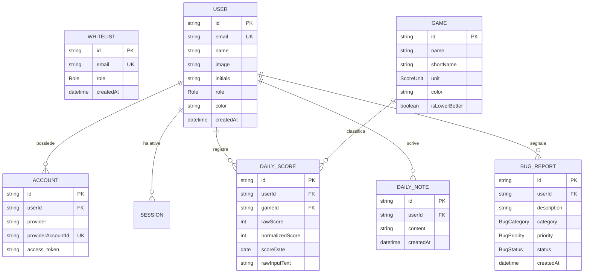

# 01. Architettura — Database e Modelli

Questo documento descrive la struttura del database relazionale, le scelte di
modellazione con **Prisma ORM v6**, le enumerazioni, i vincoli di unicità e la
gestione dell'integrità referenziale.

---

## 1. Architettura del Database

Il database dell'applicazione è **PostgreSQL 16**. La configurazione Prisma
([prisma/schema.prisma](file:///c:/Users/lucad/my-projects/who-is-losing-today/prisma/schema.prisma))
prevede due canali di connessione:

```prisma
datasource db {
  provider  = "postgresql"
  url       = env("DATABASE_URL")
  directUrl = env("DIRECT_URL")
}
```

- `DATABASE_URL`: Connection string utilizzata a runtime dall'applicazione
  (compatibile con connection pooler come PgBouncer in produzione).
- `DIRECT_URL`: Connection string per connessione TCP diretta, indispensabile
  per operazioni DDL di migrazione (`prisma db push`, `prisma migrate`).

---

## 2. Diagramma Entità-Relazione (ER)



---

## 3. Enumerazioni (Enums)

Per evitare stringhe arbitrarie ("magic strings") e garantire type-safety sia
nel DB che in TypeScript:

| Enum          | Valori                              | Utilizzo                                                                                          |
| :------------ | :---------------------------------- | :------------------------------------------------------------------------------------------------ |
| `Role`        | `ADMIN`, `PLAYER`                   | Controllo degli accessi RBAC (amministrazione whitelist, gestione bug vs uso normale).            |
| `ScoreUnit`   | `POINTS`, `ATTEMPTS`                | Specifica se il punteggio grezzo rappresenta punti (Chronophoto) o tentativi (Krilion, Metazooa). |
| `BugCategory` | `BUG`, `UI_UX`, `FEATURE`, `OTHER`  | Classificazione delle segnalazioni create nella dashboard admin.                                  |
| `BugPriority` | `LOW`, `MEDIUM`, `HIGH`, `CRITICAL` | Priorità di intervento per bug fixing e sviluppo.                                                 |
| `BugStatus`   | `OPEN`, `RESOLVED`, `CLOSED`        | Ciclo di vita della segnalazione di bug.                                                          |

---

## 4. Modelli di Dettaglio

### A. Accesso e Autenticazione: `Whitelist`, `User`, `Account`, `Session`

#### 1. `Whitelist` (`@@map("whitelist")`)

Implementa il modello ad **inviti ristretti**: nessun account può registrarsi o
accedere se la sua email non è pre-autorizzata in questa tabella.

- `email`: `String @unique` — Email Google dell'utente autorizzato.
- `role`: `Role @default(PLAYER)` — Ruolo che verrà ereditato dall'utente al
  momento del primo accesso.

#### 2. `User` (`@@map("users")`)

Rappresenta il profilo del giocatore nell'applicazione.

- `color`: `String @default("#3b82f6")` — Codice colore HEX distintivo del
  giocatore, utilizzato nei grafici Recharts, nelle barre di andamento e nel
  bordo luminoso dell'avatar.
- `initials`: `String?` — Fallback compatto visualizzato quando l'immagine
  profilo Google non è disponibile.
- `role`: `Role @default(PLAYER)` — Ruolo effettivo nel sistema.

#### 3. Modelli NextAuth Adapter (`Account`, `Session`, `VerificationToken`)

Rispettano fedelmente la specifica ufficiale di `@auth/prisma-adapter`.

- Il vincolo `@@unique([provider, providerAccountId])` su `Account` assicura che
  ogni identità Google OAuth sia univoca e associata a un unico `User`.
- `onDelete: Cascade`: Se un utente viene eliminato, tutte le sessioni e gli
  account collegati vengono rimossi a cascata.

---

### B. Motore di Gioco: `Game` e `DailyScore`

#### 1. `Game` (`@@map("games")`)

Configurazione del catalogo dei giochi supportati.

- `id`: `String @id` — Identificatore canonico (es. `"Krilion"`, `"Metazooa"`,
  `"Chronophoto"`).
- `shortName`: Sigla breve (es. `"KR"`, `"MZ"`, `"CH"`).
- `isLowerBetter`: Booleano fondamentale per l'algoritmo di normalizzazione:
  - `true` per giochi a tentativi (es. Metazooa: vincere in 3 tentativi è meglio
    che in 10).
  - `false` per giochi a punteggio (es. Chronophoto: 4.800 punti è meglio di
    1.200).
- `color`: Colore iconico del gioco per badge e tab.

#### 2. `DailyScore` (`@@map("daily_scores")`)

La tabella con il volume di dati più consistente dell'applicazione.

- `scoreDate`: **`DateTime @db.Date`** (Scelta fondamentale di design):
  > [!IMPORTANT] L'uso del tipo nativo `@db.Date` (memorizza solo `YYYY-MM-DD`
  > senza orario né timezone) elimina alla radice i problemi di slittamento di
  > data dovuti a conversioni UTC / GMT durante il passaggio tra client e
  > server.
- `rawScore`: Punteggio originale conseguito (es. `3129` punti o `4` tentativi).
- `normalizedScore`: Valore scalato in un range standardizzato `0-100` per
  consentire il confronto equo tra giochi eterogenei.
- `rawInputText`: Il testo grezzo incollato dall'utente (es. emoji e statistiche
  di condivisione), utile per audit o storico.

**Vincoli e Indici Prestazionali di `DailyScore`:**

```prisma
@@unique([userId, gameId, scoreDate])
@@index([scoreDate, gameId])
@@index([userId, scoreDate])
```

- **Unicità composita**: Garantisce a livello di vincolo database che un utente
  non possa inserire due volte il punteggio per lo stesso gioco nello stesso
  giorno (le scritture successive aggiornano il record esistente tramite
  upsert).
- **Indice `[scoreDate, gameId]`**: Velocizza la visualizzazione della
  leaderboard del giorno.
- **Indice `[userId, scoreDate]`**: Rende istantaneo il calcolo delle
  statistiche personali e dei grafici storici del giocatore.

---

### C. Collaborazione e Manutenzione: `DailyNote` e `BugReport`

#### 1. `DailyNote` (`@@map("daily_notes")`)

Bacheca temporanea (chalkboard) per sfottò e commenti della community.

- `userId`: `String` — Obbligatorio e legato via FK a `User`
  (`onDelete: Cascade`). L'autore è sempre certo e tracciato.
- `content`: `String @db.Text` — Testo del messaggio.
- `createdAt`: `DateTime @default(now())` con indice `@@index([createdAt])` per
  estrarre rapidamente solo i messaggi degli ultimi 7 giorni.

#### 2. `BugReport` (`@@map("bug_reports")`)

Piattaforma di issue tracking integrata nell'applicazione.

- `userId`: Autore della segnalazione (tracciabilità totale).
- `category` e `priority`: Classificazione per il triage degli amministratori.
- `status`: Stato di avanzamento (`OPEN`, `RESOLVED`, `CLOSED`).
- `@@index([status, priority])`: Indice per la dashboard di amministrazione
  `/admin/bugs`.

---

## 5. Regole di Integrità Referenziale

Tutte le relazioni tra modelli figli (`DailyScore`, `DailyNote`, `BugReport`,
`Account`, `Session`) e il modello padre `User` definiscono:

```prisma
onDelete: Cascade
```

Questo garantisce che l'eliminazione di un utente ripulisca automaticamente
l'intero grafo dei dati collegati senza lasciare record orfani o violazioni di
foreign key.
