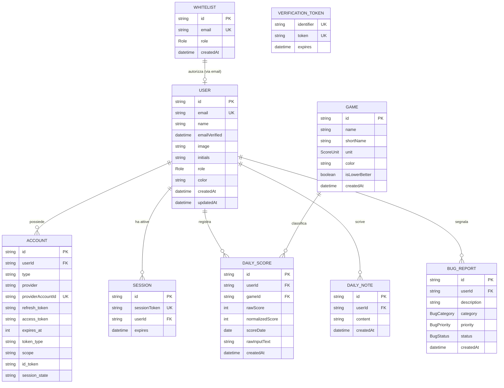

# Architettura — Database e Modelli

Questo documento descrive la struttura del database relazionale, le scelte di
modellazione con **Prisma ORM v6**, le enumerazioni, i vincoli di unicità, la
documentazione dettagliata campo per campo di ogni modello e la gestione
dell'integrità referenziale.

---

## Architettura del Database

Il database dell'applicazione è **PostgreSQL 16**. La configurazione Prisma
([prisma/schema.prisma](../../prisma/schema.prisma)) prevede due canali di
connessione:

```prisma
datasource db {
  provider  = "postgresql"
  url       = env("DATABASE_URL")
  directUrl = env("DIRECT_URL")
}
```

- `DATABASE_URL`: Connection string utilizzata a runtime dall'applicazione
  (compatibile con connection pooler come PgBouncer in produzione).
- `DIRECT_URL`: Connection string per connessione TCP diretta, indispensabile
  per operazioni DDL di migrazione (`prisma db push`, `prisma migrate`).

---

## Diagramma Entità-Relazione (ER)



### Relazione tra Whitelist e User

> [!NOTE] **Perché nello schema Prisma non c'è una Foreign Key rigida tra
> Whitelist e User?**  
> La tabella `Whitelist` definisce la lista di accessi pre-autorizzati. Un'email
> viene inserita in `Whitelist` dall'amministratore **prima** che l'utente
> effettui il suo primo accesso tramite Google OAuth (quindi prima che la riga
> in `User` esista fisicamente).  
> La relazione è dunque **logica 1-a-0..1 basata sul campo univoco `email`**:
>
> 1. Al momento del login, NextAuth cerca
>    `whitelist.findUnique({ where: { email } })`.
> 2. Se l'email è presente, NextAuth crea o aggiorna il record in `User` e
>    allinea automaticamente il ruolo (`user.role = whitelist.role`).
> 3. Se l'email non è presente, l'accesso viene bloccato e reindirizzato a
>    `/auth/unauthorized`.

---

## Enumerazioni (Enums)

Per evitare stringhe arbitrarie ("magic strings") e garantire type-safety sia
nel DB che in TypeScript:

| Enum          | Valori                              | Descrizione e Utilizzo                                                                                     |
| :------------ | :---------------------------------- | :--------------------------------------------------------------------------------------------------------- |
| `Role`        | `ADMIN`, `PLAYER`                   | Controllo accessi basato sui ruoli (RBAC). `ADMIN` gestisce whitelist e bug; `PLAYER` partecipa ai giochi. |
| `ScoreUnit`   | `POINTS`, `ATTEMPTS`                | Specifica l'unità di misura del gioco: punti (Chronophoto) o tentativi (Krilion, Metazooa).                |
| `BugCategory` | `BUG`, `UI_UX`, `FEATURE`, `OTHER`  | Classificazione funzionale delle segnalazioni inviate dagli utenti.                                        |
| `BugPriority` | `LOW`, `MEDIUM`, `HIGH`, `CRITICAL` | Grado di urgenza per il triage delle segnalazioni da parte degli amministratori.                           |
| `BugStatus`   | `OPEN`, `RESOLVED`, `CLOSED`        | Ciclo di vita della segnalazione (`OPEN` = aperta, `RESOLVED` = risolta, `CLOSED` = chiusa).               |

---

## Modelli di Dettaglio (Documentazione Campo per Campo)

Di seguito viene descritto ogni singolo modello di
[prisma/schema.prisma](../../prisma/schema.prisma) con il dettaglio di tutti i
campi, tipi e vincoli.

---

### Modello `Whitelist` (`@@map("whitelist")`)

Rappresenta la lista di controllo degli accessi. Consente la registrazione e
l'accesso solo agli account esplicitamente invitati.

| Campo       | Tipo Prisma & DB       | Modificatori / Vincoli | Descrizione Dettagliata                                                                      |
| :---------- | :--------------------- | :--------------------- | :------------------------------------------------------------------------------------------- |
| `id`        | `String` (TEXT)        | `@id @default(cuid())` | Identificativo univoco generato automaticamente in formato CUID.                             |
| `email`     | `String` (TEXT)        | `@unique`              | Indirizzo email autorizzato ad accedere (deve corrispondere all'account Google dell'utente). |
| `role`      | `Role` (ENUM)          | `@default(PLAYER)`     | Ruolo assegnato all'utente al primo accesso (`ADMIN` o `PLAYER`).                            |
| `createdAt` | `DateTime` (TIMESTAMP) | `@default(now())`      | Data e ora di inserimento dell'email nella whitelist.                                        |

---

### Modello `User` (`@@map("users")`)

Rappresenta il profilo del giocatore nel sistema.

| Campo           | Tipo Prisma & DB        | Modificatori / Vincoli | Descrizione Dettagliata                                                                            |
| :-------------- | :---------------------- | :--------------------- | :------------------------------------------------------------------------------------------------- |
| `id`            | `String` (TEXT)         | `@id @default(cuid())` | Identificativo univoco del giocatore nel sistema (chiave primaria).                                |
| `name`          | `String?` (TEXT)        | `nullable`             | Nome visualizzato del giocatore (ereditato dal profilo Google OAuth o personalizzato).             |
| `email`         | `String?` (TEXT)        | `@unique, nullable`    | Indirizzo email del giocatore. Univoco in tutto il sistema.                                        |
| `emailVerified` | `DateTime?` (TIMESTAMP) | `nullable`             | Timestamp di verifica email (fornito dal protocollo OAuth).                                        |
| `image`         | `String?` (TEXT)        | `nullable`             | URL dell'avatar profilo dell'utente (scaricato da Google Identity).                                |
| `initials`      | `String?` (TEXT)        | `nullable`             | Iniziali brevi (es. "LD", "SB") usate come fallback se l'immagine profilo non è disponibile.       |
| `role`          | `Role` (ENUM)           | `@default(PLAYER)`     | Ruolo effettivo nel sistema. Sincronizzato con il ruolo in `Whitelist`.                            |
| `color`         | `String` (TEXT)         | `@default("#3b82f6")`  | Codice colore esadecimale (HEX) distintivo del giocatore per i grafici Recharts e il bordo avatar. |
| `createdAt`     | `DateTime` (TIMESTAMP)  | `@default(now())`      | Data e ora di creazione del profilo utente.                                                        |
| `updatedAt`     | `DateTime` (TIMESTAMP)  | `@updatedAt`           | Data e ora dell'ultimo aggiornamento del profilo (aggiornato automaticamente da Prisma).           |
| `accounts`      | `Account[]`             | Relazione 1-a-molti    | Account OAuth collegati all'utente (NextAuth).                                                     |
| `sessions`      | `Session[]`             | Relazione 1-a-molti    | Sessioni attive dell'utente su database (NextAuth).                                                |
| `dailyScores`   | `DailyScore[]`          | Relazione 1-a-molti    | Tutti i punteggi storici registrati dal giocatore.                                                 |
| `dailyNotes`    | `DailyNote[]`           | Relazione 1-a-molti    | Messaggi e commenti pubblicati dall'utente sulla bacheca giornaliera.                              |
| `bugReports`    | `BugReport[]`           | Relazione 1-a-molti    | Segnalazioni di bug inviate dall'utente.                                                           |

---

### Modello `Account` (`@@map("accounts")`)

Modello standard richiesto da `@auth/prisma-adapter` per gestire l'identità
federata Google OAuth 2.0.

| Campo               | Tipo Prisma & DB       | Modificatori / Vincoli | Descrizione Dettagliata                                                           |
| :------------------ | :--------------------- | :--------------------- | :-------------------------------------------------------------------------------- |
| `id`                | `String` (TEXT)        | `@id @default(cuid())` | Identificativo univoco dell'associazione account.                                 |
| `userId`            | `String` (TEXT)        | FK verso `User.id`     | Riferimento al giocatore proprietario dell'account (`onDelete: Cascade`).         |
| `type`              | `String` (TEXT)        | Obbligatorio           | Tipo di account (es. `"oauth"`).                                                  |
| `provider`          | `String` (TEXT)        | Obbligatorio           | Identificativo del provider di autenticazione (es. `"google"`).                   |
| `providerAccountId` | `String` (TEXT)        | Obbligatorio           | ID univoco dell'utente restituito da Google (il claim `sub` di OpenID Connect).   |
| `refresh_token`     | `String?` (`@db.Text`) | `nullable`             | Token OAuth di refresh a lungo termine per rinnovare l'access token.              |
| `access_token`      | `String?` (`@db.Text`) | `nullable`             | Token di accesso OAuth a breve termine rilasciato da Google.                      |
| `expires_at`        | `Int?` (INTEGER)       | `nullable`             | Timestamp Unix di scadenza dell'access token.                                     |
| `token_type`        | `String?` (TEXT)       | `nullable`             | Tipo di token restituito da Google (es. `"Bearer"`).                              |
| `scope`             | `String?` (TEXT)       | `nullable`             | Permessi concessi dall'utente durante il consenso (es. `"email profile openid"`). |
| `id_token`          | `String?` (`@db.Text`) | `nullable`             | Token JWT firmato crittograficamente da Google contenente l'identità dell'utente. |
| `session_state`     | `String?` (TEXT)       | `nullable`             | Stato di sessione OAuth (specifico OIDC).                                         |
| `user`              | `User`                 | Relazione              | Riferimento al modello `User`.                                                    |

- **Vincolo di Unicità**: `@@unique([provider, providerAccountId])` — Assicura
  che un account Google non possa essere associato a più di un utente locale.

---

### Modello `Session` (`@@map("sessions")`)

Gestisce le sessioni su database per NextAuth (quando non si usa solo la
strategia JWT pura).

| Campo          | Tipo Prisma & DB       | Modificatori / Vincoli | Descrizione Dettagliata                                                        |
| :------------- | :--------------------- | :--------------------- | :----------------------------------------------------------------------------- |
| `id`           | `String` (TEXT)        | `@id @default(cuid())` | Identificativo univoco della sessione.                                         |
| `sessionToken` | `String` (TEXT)        | `@unique`              | Token di sessione casuale ad alta entropia memorizzato nel cookie del browser. |
| `userId`       | `String` (TEXT)        | FK verso `User.id`     | Utente proprietario della sessione (`onDelete: Cascade`).                      |
| `expires`      | `DateTime` (TIMESTAMP) | Obbligatorio           | Data e ora di scadenza della sessione.                                         |
| `user`         | `User`                 | Relazione              | Riferimento al modello `User`.                                                 |

---

### Modello `VerificationToken` (`@@map("verification_tokens")`)

Utilizzato da NextAuth per la verifica email e passwordless magic links.

| Campo        | Tipo Prisma & DB       | Modificatori / Vincoli | Descrizione Dettagliata                                      |
| :----------- | :--------------------- | :--------------------- | :----------------------------------------------------------- |
| `identifier` | `String` (TEXT)        | Obbligatorio           | Identificatore del target di verifica (tipicamente l'email). |
| `token`      | `String` (TEXT)        | `@unique`              | Token crittografico monouso per la verifica.                 |
| `expires`    | `DateTime` (TIMESTAMP) | Obbligatorio           | Timestamp di scadenza del token di verifica.                 |

- **Vincoli di Unicità**: `@@unique([identifier, token])` — Garantisce che la
  combinazione email e token sia univoca.

---

### Modello `Game` (`@@map("games")`)

Configurazione del catalogo dei giochi supportati nel sistema.

| Campo           | Tipo Prisma & DB       | Modificatori / Vincoli  | Descrizione Dettagliata                                                                           |
| :-------------- | :--------------------- | :---------------------- | :------------------------------------------------------------------------------------------------ |
| `id`            | `String` (TEXT)        | `@id` (Chiave primaria) | Identificativo stringa canonico (es. `"Krilion"`, `"Metazooa"`, `"Chronophoto"`).                 |
| `name`          | `String` (TEXT)        | Obbligatorio            | Nome completo del gioco visualizzato nell'interfaccia utente.                                     |
| `shortName`     | `String` (TEXT)        | Obbligatorio            | Sigla breve di 2 caratteri per badge e grafici (es. `"KR"`, `"MZ"`, `"CH"`).                      |
| `unit`          | `ScoreUnit` (ENUM)     | `@default(POINTS)`      | Unità di misura del punteggio (`POINTS` o `ATTEMPTS`).                                            |
| `color`         | `String` (TEXT)        | `@default("#10b981")`   | Colore esadecimale caratteristico del gioco per tab, badge e card.                                |
| `isLowerBetter` | `Boolean` (BOOLEAN)    | `@default(false)`       | Booleano critico per l'algoritmo: se `true`, un punteggio numerico minore è migliore (tentativi). |
| `createdAt`     | `DateTime` (TIMESTAMP) | `@default(now())`       | Data di inserimento del gioco nel catalogo.                                                       |
| `dailyScores`   | `DailyScore[]`         | Relazione 1-a-molti     | Tutti i punteggi registrati per questo gioco.                                                     |

---

### Modello `DailyScore` (`@@map("daily_scores")`)

La tabella centrale dell'applicazione contenente i singoli punteggi giornalieri.

| Campo             | Tipo Prisma & DB        | Modificatori / Vincoli | Descrizione Dettagliata                                                                                          |
| :---------------- | :---------------------- | :--------------------- | :--------------------------------------------------------------------------------------------------------------- |
| `id`              | `String` (TEXT)         | `@id @default(cuid())` | Identificativo univoco della registrazione del punteggio.                                                        |
| `userId`          | `String` (TEXT)         | FK verso `User.id`     | Giocatore che ha realizzato il punteggio (`onDelete: Cascade`).                                                  |
| `gameId`          | `String` (TEXT)         | FK verso `Game.id`     | Gioco di riferimento (`onDelete: Cascade`).                                                                      |
| `rawScore`        | `Int` (INTEGER)         | Obbligatorio           | Punteggio grezzo effettivo (es. `3129` punti o `3` tentativi).                                                   |
| `normalizedScore` | `Int` (INTEGER)         | Obbligatorio           | Punteggio normalizzato in scala standard `0 - 1000` calcolato dal sistema.                                       |
| `scoreDate`       | `DateTime` (`@db.Date`) | Obbligatorio           | Data solare pura (`YYYY-MM-DD`). Il tipo nativo `@db.Date` esclude l'orario ed elimina i bug di fuso orario UTC. |
| `rawInputText`    | `String?` (TEXT)        | `nullable`             | Testo grezzo incollato dall'utente al momento dell'inserimento (per audit o archivio).                           |
| `createdAt`       | `DateTime` (TIMESTAMP)  | `@default(now())`      | Timestamp di inserimento del record.                                                                             |
| `user`            | `User`                  | Relazione              | Riferimento al modello `User`.                                                                                   |
| `game`            | `Game`                  | Relazione              | Riferimento al modello `Game`.                                                                                   |

- **Vincolo di Unicità**: `@@unique([userId, gameId, scoreDate])` — Impedisce
  che un giocatore inserisca due punteggi per lo stesso gioco nello stesso
  giorno.
- **Indici Prestazionali**:
  - `@@index([scoreDate, gameId])`: Rende istantanea l'estrazione della
    classifica giornaliera per gioco.
  - `@@index([userId, scoreDate])`: Velocizza il calcolo dei grafici temporali e
    dello storico personale dell'utente.

---

### Modello `DailyNote` (`@@map("daily_notes")`)

Messaggi e commenti della bacheca temporanea (chalkboard).

| Campo       | Tipo Prisma & DB       | Modificatori / Vincoli | Descrizione Dettagliata                                                                                           |
| :---------- | :--------------------- | :--------------------- | :---------------------------------------------------------------------------------------------------------------- |
| `id`        | `String` (TEXT)        | `@id @default(cuid())` | Identificativo univoco del messaggio.                                                                             |
| `userId`    | `String` (TEXT)        | FK verso `User.id`     | Autore del messaggio. Obbligatorio per garantire tracciabilità e permessi di cancellazione (`onDelete: Cascade`). |
| `content`   | `String` (`@db.Text`)  | Obbligatorio           | Testo del messaggio/sfottò pubblicato (massimo 500 caratteri validati da Zod).                                    |
| `createdAt` | `DateTime` (TIMESTAMP) | `@default(now())`      | Timestamp di pubblicazione.                                                                                       |
| `user`      | `User`                 | Relazione              | Riferimento al modello `User` dell'autore.                                                                        |

- **Indice Prestazionale**: `@@index([createdAt])` — Ottimizza la query che
  recupera solo i messaggi degli ultimi 7 giorni.

---

### Modello `BugReport` (`@@map("bug_reports")`)

Piattaforma interna per il tracciamento di bug, anomalie e richieste di
miglioramento.

| Campo         | Tipo Prisma & DB       | Modificatori / Vincoli | Descrizione Dettagliata                                            |
| :------------ | :--------------------- | :--------------------- | :----------------------------------------------------------------- |
| `id`          | `String` (TEXT)        | `@id @default(cuid())` | Identificativo univoco della segnalazione.                         |
| `userId`      | `String` (TEXT)        | FK verso `User.id`     | Giocatore che ha inviato la segnalazione (`onDelete: Cascade`).    |
| `description` | `String` (`@db.Text`)  | Obbligatorio           | Descrizione testuale dettagliata del problema o della richiesta.   |
| `category`    | `BugCategory` (ENUM)   | `@default(BUG)`        | Categoria della segnalazione (`BUG`, `UI_UX`, `FEATURE`, `OTHER`). |
| `priority`    | `BugPriority` (ENUM)   | `@default(MEDIUM)`     | Priorità assegnata (`LOW`, `MEDIUM`, `HIGH`, `CRITICAL`).          |
| `status`      | `BugStatus` (ENUM)     | `@default(OPEN)`       | Stato di lavorazione (`OPEN`, `RESOLVED`, `CLOSED`).               |
| `createdAt`   | `DateTime` (TIMESTAMP) | `@default(now())`      | Data e ora di invio della segnalazione.                            |
| `user`        | `User`                 | Relazione              | Riferimento al modello `User` del segnalatore.                     |

- **Indice Prestazionale**: `@@index([status, priority])` — Velocizza il
  caricamento della dashboard amministrativa `/admin/bugs` ordinata per stato e
  priorità.

---

## Regole di Integrità Referenziale

Tutte le relazioni tra modelli secondari (`DailyScore`, `DailyNote`,
`BugReport`, `Account`, `Session`) e il modello principale `User` applicano:

```prisma
onDelete: Cascade
```

Se un account utente viene eliminato, PostgreSQL elimina automaticamente tutti i
suoi punteggi, note, sessioni e account OAuth collegati, impedendo la presenza
di record orfani o inconsistenze referenziali.
