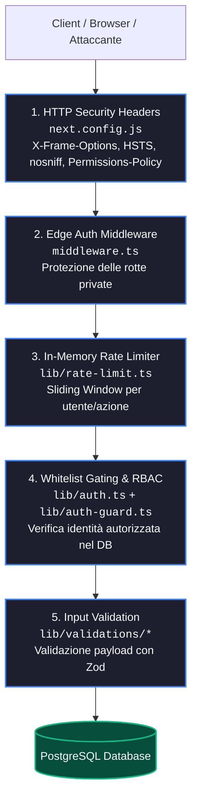

# Architettura — Hardening e Misure di Sicurezza

Questo documento fornisce una panoramica tecnica esaustiva di tutte le misure di **sicurezza applicativa, difensiva e di pipeline (DevSecOps)** implementate in *Who Is Losing Today?*.

---

## 🛡️ Modello di Difesa in Profondità (_Defense in Depth_)

La sicurezza dell'applicazione non è delegata a un singolo componente, ma è strutturata su più barriere difensive indipendenti:



---

## 1. Intestazioni HTTP di Sicurezza (`next.config.js`)

Nel file `next.config.js` è configurata la funzione `headers()` che inietta automaticamente le intestazioni HTTP consigliate da OWASP su tutte le rotte (`/:path*`):

| Intestazione HTTP | Valore Configurato | Obiettivo di Sicurezza | Attacco Sventato |
| :--- | :--- | :--- | :--- |
| **`X-Frame-Options`** | `DENY` | Impedisce che l'applicazione venga incorporata in tag `<iframe>` o `<frame>` di qualsiasi sito web. | **Clickjacking**: impedisce che un sito terzo sovrapponga bottoni fittizi sopra bottoni reali dell'app. |
| **`X-Content-Type-Options`** | `nosniff` | Forza il browser ad attenersi rigorosamente al `Content-Type` inviato dal server. | **MIME-confusion XSS**: impedisce l'esecuzione di file mascherati (es. `.txt` o immagini contenenti codice JS). |
| **`Referrer-Policy`** | `strict-origin-when-cross-origin` | Invia l'intero percorso solo all'interno del dominio dell'app; per richieste verso terzi trasmette solo l'origine generica (`https://dominio.it/`). | **Data Leakage**: evita che token di autenticazione o parametri privati nell'URL finiscano nei server dei giochi esterni. |
| **`Permissions-Policy`** | `camera=(), microphone=(), geolocation=(), browsing-topics=()` | Disabilita a livello browser l'accesso ad API hardware e tracciamento. | **Abuso di permessi e script malevoli**: garantisce che nessuna risorsa terza possa accedere a webcam, microfono o posizione. |
| **`Strict-Transport-Security`** | `max-age=63072000; includeSubDomains; preload` | Forza l'uso esclusivo di connessioni HTTPS per 2 anni per il dominio e tutti i sottodomini. | **Man-in-the-Middle (MitM) & SSL-Stripping**: protegge le sessioni su reti Wi-Fi pubbliche non sicure. |
| **`X-DNS-Prefetch-Control`** | `on` | Abilita la risoluzione DNS preventiva per i collegamenti esterni ai puzzle game. | **Performance & Latency**: velocizza il caricamento dei siti esterni senza impatti sulla sicurezza. |

---

## 2. Rate Limiting Applicativo (`lib/rate-limit.ts`)

Per proteggere il database PostgreSQL e le Server Actions da attacchi di flooding, spam o Denial of Service (DoS), è stato implementato un rate limiter in-memory basato su **Sliding Window**.

### Caratteristiche Tecniche:
- **Zero dipendenze esterne**: opera direttamente nella memoria del runtime Node.js, perfetto per container singoli standalone.
- **Garbage Collection automatica**: un timer periodico non bloccante (`unref()`) rimuove le chiavi scadute per evitare memory leak.
- **Tracciamento Utente nei Log**: i log di sicurezza registrano direttamente nome ed email dell'utente (`"Mario Rossi (mario@email.com)"`) per audit immediato nei log Docker.
- **Helper Centralizzato `enforceUserRateLimit`**: elimina codice ripetuto nelle Server Actions occupandosi della formattazione uniforme dei messaggi e dei tempi di attesa.
- **Politiche Centralizzate (`RATE_LIMIT_POLICIES`)**: le soglie di tutti gli endpoint sono configurate in un unico punto.
- **Penalità Progressiva (Jail)**:
  - Superamento iniziale: blocco standard per la durata residua della finestra temporale.
  - Insistenza media ($\ge 2\times$ limite): attivazione **Jail Livello 1** con sospensione forzata di **5 minuti**.
  - Insistenza massiva ($\ge 4\times$ limite): attivazione **Jail Livello 2** con sospensione estesa di **30 minuti**.

### Soglie Attive:
- **Inserimento Punteggi (`submitScoreAction`)**: max 15 richieste al minuto per utente.
- **Pubblicazione Note (`createNoteAction`)**: max 6 note al minuto per utente.
- **Segnalazione Bug (`POST /api/bugs`)**: max 5 segnalazioni ogni 5 minuti per utente (ritorna HTTP 429 *Too Many Requests*).

---

## 3. Validazione delle Variabili d'Ambiente (`lib/env.ts`)

Un errore comune nei deploy Docker è l'avvio di container con variabili d'ambiente mancanti o malformate (es. secret troppo corti o stringhe di connessione DB errate).

### Schema di Validazione Zod:
In `lib/env.ts` è definito uno schema che convalida le variabili critiche:
- `DATABASE_URL`: deve essere una stringa valida e non vuota.
- `NEXTAUTH_SECRET`: deve contenere almeno 16 caratteri ad alta entropia.
- `NEXTAUTH_URL`: deve essere un URL HTTP/HTTPS valido.
- `NODE_ENV`: deve essere `development`, `production` o `test`.

### Protezione del Build Docker:
La funzione `validateEnv()` distingue la fase di compilazione (`next build` / Docker multi-stage) dal runtime effettivo: durante la compilazione delle pagine statiche i segreti possono non essere presenti, mentre a runtime in produzione il server blocca l'esecuzione e segnala puntualmente la configurazione errata nei log.

---

## 4. Pipeline DevSecOps & Security Scanning (CI/CD)

La sicurezza del codice e delle dipendenze è integrata direttamente nei workflow di GitHub Actions:

### A. Scansione Vulnerabilità Dipendenze (`.github/workflows/ci.yml`)
Durante ogni build di CI sui branch `master` e `dev`:
```yaml
- name: Run Dependency Security Audit
  run: npm audit --audit-level=high
```
Se una libreria terza presenta vulnerabilità note (CVE) con gravità **High** o **Critical**, la pipeline fallisce immediatamente, impedendo il rilascio di codice vulnerabile.

### B. SAST (Static Application Security Testing) con GitHub CodeQL (`.github/workflows/codeql.yml`)
Il workflow CodeQL esegue l'analisi statica semantica del codice sorgente JavaScript e TypeScript:
- **Trigger bilanciato**: si attiva sui `push` e sulle `pull_request` verso i branch `master` e `dev`, oltre a una scansione preventiva mensile (`schedule: cron '0 6 1 * *'`) per intercettare nuove vulnerabilità zero-day scoperte nel tempo senza sprecare minuti Actions.
- **Analisi del Flusso Dati (Data-Flow)**: controlla che nessun dato in ingresso dall'utente arrivi a query database o a comandi di sistema senza essere validato.
- **OWASP Top 10**: rileva preventivamente pattern di SQL Injection, XSS, bypass di autenticazione e secret hardcoded.
- **Integrazione Nativa**: gli alert vengono pubblicati direttamente nel tab **Security -> Code scanning** della repository GitHub.
