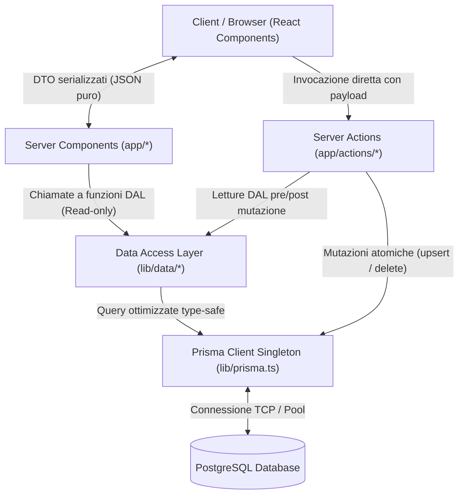

# Backend e DAL — Design del Data Access Layer

Questo documento descrive il pattern architetturale del **Data Access Layer
(DAL)** adottato in **Who Is Losing Today?**, la separazione dei domini
applicativi, la gestione dei Data Transfer Objects (DTO) e le strategie di
ottimizzazione delle query.

---

## Perché un Data Access Layer (DAL)?

Nel Next.js App Router, i Server Components e le Server Actions hanno accesso
diretto al database. Tuttavia, scrivere query Prisma direttamente all'interno
delle pagine JSX o delle Server Actions crea:

- **Accoppiamento stretto**: Modifiche allo schema del database romperebbero
  direttamente i componenti UI.
- **Duplicazione di logica di calcolo**: Normalizzazione punteggi, calcolo del
  perdente e aggregazioni medie verrebbero ripetuti in più punti.
- **Query inefficienti**: Rischio di incorrere nel problema `N+1` e
  over-fetching di campi non necessari.

Il **DAL** risiede interamente in [lib/data/](../../lib/data/) ed è l'unico
modulo autorizzato a eseguire query Prisma di lettura:



---

## Suddivisione dei Moduli del DAL

Il DAL è strutturato per domini di responsabilità indipendenti:

| Modulo           | File                                              | Responsabilità                                                                                  | Funzioni Principali                                |
| :--------------- | :------------------------------------------------ | :---------------------------------------------------------------------------------------------- | :------------------------------------------------- |
| **Daily**        | [daily.ts](../../lib/data/daily.ts)               | Risultati di una singola data solare (`YYYY-MM-DD`).                                            | `getDailyResults(dateStr)`                         |
| **Period**       | [period.ts](../../lib/data/period.ts)             | Classifiche aggregate e andamenti temporali per periodo (`week`, `month`, `last_month`, `all`). | `getPeriodResults(preset, customRange?)`           |
| **Hall of Fame** | [hall-of-fame.ts](../../lib/data/hall-of-fame.ts) | Record storici assoluti per ciascun gioco e punteggio totale.                                   | `getHallOfFame()`                                  |
| **User Profile** | [user.ts](../../lib/data/user.ts)                 | Gamer Card dell'utente, serie temporali personali, streak e statistiche trofei.                 | `getUserProfile(userId)`, `getUserSummary(userId)` |
| **Notes**        | [notes.ts](../../lib/data/notes.ts)               | Bacheca e messaggi degli ultimi 7 giorni.                                                       | `getRecentNotes(limit)`                            |
| **Admin**        | [admin.ts](../../lib/data/admin.ts)               | Dati per la dashboard amministrativa (Whitelist e Bug Reports).                                 | `getWhitelistUsers()`, `getBugReports(status?)`    |

---

## Disaccoppiamento tramite DTO (Data Transfer Objects)

I modelli Prisma non vengono mai restituiti "puri" al frontend. Il DAL trasforma
i risultati in **DTO tipizzati** definiti in [lib/types/](../../lib/types/) (per
la reference completa di ciascun modello, consulta la guida dedicata
[Modelli DTO e Contratti di Tipo](./dtos-and-types.md)):

### Vantaggi dei DTO:

1. **Serializzazione pulita**: I campi `Date` vengono convertiti in stringhe
   standard (`YYYY-MM-DD` o ISO), prevenendo errori di serializzazione
   Server-to-Client in Next.js.
2. **Privacy dei dati**: Campi sensibili come token OAuth, hash o email private
   non vengono mai esposti al client (es. `UserSummaryDTO` espone solo `id`,
   `name`, `color`, `image`, `initials`).
3. **Calcoli arricchiti**: I DTO incorporano proprietà calcolate dal DAL che non
   esistono nel DB fisico (es. `rank`, `normalizedScore`, `isWinner`, `isLoser`,
   `streak`).

### Esempio: `DailyResultsDTO`

```typescript
export interface DailyResultsDTO {
  date: string; // "YYYY-MM-DD"
  totalPlayers: number;
  winner: DailyPlayerScore | null;
  loser: DailyPlayerScore | null; // null se meno di 2 partecipanti
  rankings: {
    totale: DailyPlayerScore[];
    byGame: Record<string, DailyPlayerScore[]>;
    krilion?: DailyPlayerScore[];
    metazooa?: DailyPlayerScore[];
    chronophoto?: DailyPlayerScore[];
  };
}
```

---

## Ottimizzazione delle Query ed Eliminazione di N+1

Nel DAL ogni funzione è progettata per eseguire il numero minimo di query
PostgreSQL:

### Esempio in `getDailyResults`:

Invece di eseguire una query per ogni utente e per ogni gioco:

```typescript
// 1. Una singola query estrae tutti i punteggi del giorno con JOIN all'utente
const scores = await prisma.dailyScore.findMany({
  where: { scoreDate: targetDate },
  include: {
    user: {
      select: { id: true, name: true, color: true, image: true },
    },
  },
});

// 2. L'aggregazione e il calcolo del rank avvengono in-memory in O(N log N)
const userMap = new Map<string, UserAggregate>();
scores.forEach((sc) => {
  /* raggruppa punteggi per userId */
});
```

Risultato: **2 sole query SQL complessive** (1 per il catalogo giochi, 1 per
tutti i punteggi del giorno), indipendentemente dal numero di giocatori o giochi
registrati.

---

## Gestione del Connection Pooling

Le query passano attraverso il client Prisma configurato come singleton in
[lib/prisma.ts](../../lib/prisma.ts):

```typescript
import { PrismaClient } from '@prisma/client';

const globalForPrisma = globalThis as unknown as { prisma: PrismaClient };

export const prisma =
  globalForPrisma.prisma ||
  new PrismaClient({
    log: process.env.NODE_ENV === 'development' ? ['warn', 'error'] : ['error'],
  });

if (process.env.NODE_ENV !== 'production') globalForPrisma.prisma = prisma;
```

Questo singleton previene l'esaurimento delle connessioni al database durante
l'Hot Module Replacement (HMR) in sviluppo locale e garantisce il riutilizzo
ottimale del pool in produzione.
