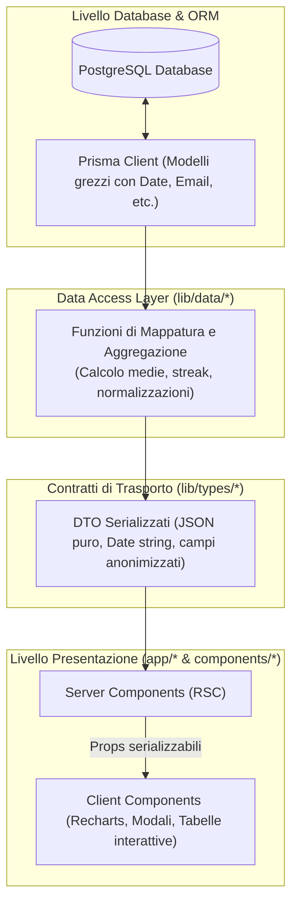

# Backend e DAL — Modelli DTO e Contratti di Tipo

Questo documento fornisce la reference completa e approfondita di tutti i **Data
Transfer Objects (DTO)** e dei tipi TypeScript definiti in
[lib/types/](../../lib/types/). Descrive la motivazione architetturale alla base
del pattern DTO, i contratti per ciascun dominio applicativo, le regole di
serializzazione JSON e il disaccoppiamento dai modelli del database Prisma.

---

## Perché Usare i DTO al Posto dei Modelli Prisma?

Nei moderni framework full-stack come Next.js (App Router), i componenti React
Server Components (RSC) e Client Components comunicano attraverso i confini di
rete. Esporre direttamente le entità generate da Prisma (`@prisma/client`)
presenta gravi problemi architetturali:

1. **Information Leakage (Sicurezza e Privacy)**:  
   I modelli Prisma contengono campi sensibili o interni come l'indirizzo email
   dell'utente (`User.email`), i token di sessione, gli ID interni o audit
   timestamps non rilevanti per l'interfaccia. Un DTO espone esclusivamente le
   proprietà necessarie per la vista specifica (`UserSummaryDTO`: solo `id`,
   `name`, `color`, `image`).
2. **Serializzazione JSON nei Client Components**:  
   Next.js impone che qualsiasi dato passato da un Server Component a un Client
   Component (`'use client'`) sia serializzabile in JSON. Gli oggetti JavaScript
   nativi `Date` generati da Prisma provocano warning o errori di idratazione se
   non serializzati in stringhe ISO o formati pre-calcolati (`YYYY-MM-DD`).
3. **Calcoli e Metriche di Business Aggregati**:  
   I dati visualizzati nel frontend spesso non risiedono in una singola riga del
   database. Classifiche aggregate, medie ponderate, serie storiche per grafici
   Recharts, streak correnti, conteggi di trofei e cucchiai di legno vengono
   calcolati e arricchiti all'interno del DAL e incapsulati in un DTO ad-hoc.
4. **Disaccoppiamento e Resilienza ai Cambiamenti del Database**:  
   Se la struttura delle tabelle PostgreSQL cambia (es. una migrazione di schema
   o la rinomina di una colonna), i componenti React non subiscono alcun impatto
   finché il DTO mantiene invariato il proprio contratto.



---

## Catalogo Completo dei DTO per Dominio

Tutti i tipi sono esportati centralmente tramite l'entry point
[lib/types/index.ts](../../lib/types/index.ts).

### Dominio Utente ([lib/types/user.ts](../../lib/types/user.ts))

#### `UserSummaryDTO`

Rappresenta l'identità minima e pubblica di un giocatore, riutilizzata come
blocco fondamentale in tutti gli altri DTO (classifiche, note, hall of fame, bug
report):

```typescript
export interface UserSummaryDTO {
  id: string; // Identificativo univoco
  name: string; // Nickname o nome visualizzato
  color: string; // Colore esadecimale (es. "#3b82f6")
  image?: string | null; // URL avatar Google o null
}
```

#### `GameStatsSummary`

Sintesi statistica per un singolo gioco all'interno della Gamer Card
dell'utente:

```typescript
export interface GameStatsSummary {
  played: number; // Numero totale di partite giocate
  averageScore: number; // Media normalizzata (0-1000)
  bestScore: number; // Punteggio record personale
}
```

#### `UserPersonalTrendPoint`

Punto dati per il grafico storico personale dell'utente (ultimi 14 giorni):

```typescript
export interface UserPersonalTrendPoint {
  date: string; // Data formattata ("18 Ott")
  krilion?: number; // Punteggio normalizzato Krilion
  metazooa?: number; // Punteggio normalizzato Metazooa
  chronophoto?: number; // Punteggio normalizzato Chronophoto
  totale?: number; // Media complessiva del giorno
}
```

#### `UserProfileDTO`

Oggetto completo per la visualizzazione della pagina profilo (`/profile` o
`/profile/[userId]`):

```typescript
export interface UserProfileDTO {
  user: UserSummaryDTO;
  role: Role; // 'PLAYER' | 'ADMIN'
  streak: number; // Giorni consecutivi di gioco attuali
  streakRecord: number; // Record storico di giorni consecutivi
  totalGamesPlayed: number; // Somma di tutte le partite giocate
  woodenSpoonsCount: number; // Numero di volte ultimo del giorno (🥄)
  dailyWinsCount: number; // Numero di volte primo del giorno (🥇)
  statsByGame: {
    krilion: GameStatsSummary;
    metazooa: GameStatsSummary;
    chronophoto: GameStatsSummary;
  };
  personalTrend: UserPersonalTrendPoint[];
}
```

---

### Dominio Risultati Giornalieri ([lib/types/daily.ts](../../lib/types/daily.ts))

#### `DailyPlayerScore`

Posizione e punteggi di un giocatore in una singola classifica:

```typescript
export interface DailyPlayerScore {
  user: UserSummaryDTO; // Giocatore associato
  rawScore: number; // Punteggio grezzo originale (es. 3200 o 3)
  normalizedScore: number; // Punteggio normalizzato (0-1000)
  rank: number; // Posizione in classifica (1, 2, 3...)
}
```

#### `DailyResultsDTO`

Oggetto aggregato che racchiude l'intero stato competitivo di una specifica
giornata (`getDailyResults(dateStr)`):

```typescript
export interface DailyResultsDTO {
  date: string; // "YYYY-MM-DD"
  totalPlayers: number; // Numero di giocatori partecipanti
  winner: DailyPlayerScore | null; // Primo classificato nel Totale
  loser: DailyPlayerScore | null; // Ultimo classificato (null se totalPlayers < 2)
  rankings: {
    totale: DailyPlayerScore[]; // Classifica generale giornaliera
    byGame: Record<string, DailyPlayerScore[]>; // Classifiche dinamiche indicizzate per gameId
    krilion?: DailyPlayerScore[]; // Retrocompatibilità
    metazooa?: DailyPlayerScore[]; // Retrocompatibilità
    chronophoto?: DailyPlayerScore[]; // Retrocompatibilità
    [key: string]:
      DailyPlayerScore[] | Record<string, DailyPlayerScore[]> | undefined;
  };
}
```

> [!NOTE] Il campo `loser` viene valorizzato a `null` se in quel giorno ha
> giocato un solo giocatore (`totalPlayers < 2`), applicando a livello di DAL la
> regola di salvaguardia del cucchiaio di legno.

---

### Dominio Statistiche di Periodo e Hall of Fame ([lib/types/period.ts](../../lib/types/period.ts))

#### `PeriodPreset`

Filtri temporali predefiniti per aggregazioni:

```typescript
export const PERIOD_PRESETS = ['week', 'month', 'last_month', 'all'] as const;
export type PeriodPreset = (typeof PERIOD_PRESETS)[number];
```

#### `PeriodLeaderboardRow`

Riga della tabella di classifica aggregata su un intervallo di date:

```typescript
export interface PeriodLeaderboardRow {
  user: UserSummaryDTO;
  playedCount: number; // Giornate completate nel periodo
  totalPoints: number; // Somma dei punteggi normalizzati
  averageScore: number; // Media normalizzata (criterio di ordinamento principale)
  bestScore: number; // Miglior punteggio nel periodo
  rank: number; // Posizione in classifica
}
```

#### `TrendPointDTO`

Formato ottimizzato per la libreria grafica Recharts, contenente la data in
ascissa e una serie di chiavi dinamiche per ciascun utente in ordinata:

```typescript
export interface TrendPointDTO {
  date: string; // Etichetta data in ascissa (es. "12 Ott")
  [userId: string]: string | number; // es: { date: "12 Ott", "usr_1": 850, "usr_2": 420 }
}
```

#### `PeriodGameData`

Coppia di classifica aggregata e andamento temporale per un singolo gioco o per
il totale:

```typescript
export interface PeriodGameData {
  leaderboard: PeriodLeaderboardRow[];
  trendData: TrendPointDTO[];
}
```

#### `PeriodResultsDTO`

Risposta completa per il monitoraggio competitivo periodico
(`getPeriodResults(preset)`):

```typescript
export interface PeriodResultsDTO {
  startDate: string; // ISO date string "YYYY-MM-DD"
  endDate: string; // ISO date string "YYYY-MM-DD"
  players: UserSummaryDTO[]; // Giocatori presenti (usati per definire i colori delle linee nel grafico)
  totale: PeriodGameData; // Dati aggregati per il punteggio complessivo
  byGame: Record<string, PeriodGameData>; // Dati suddivisi per singolo gioco
  krilion?: PeriodGameData;
  metazooa?: PeriodGameData;
  chronophoto?: PeriodGameData;
}
```

#### `AllTimeRecordItem` e `HallOfFameDTO`

I primati assoluti storici memorizzati e calcolati dal database:

```typescript
export interface AllTimeRecordItem {
  gameId: string; // "Krilion", "Metazooa", "Chronophoto", "Totale"
  score: number; // Punteggio record
  unit: string; // Unità di misura ("pt", "tentativi")
  date: string; // Data del record ("YYYY-MM-DD")
  holder: UserSummaryDTO; // Giocatore detentore del record
}

export interface HallOfFameDTO {
  totale: AllTimeRecordItem | null;
  byGame: Record<string, AllTimeRecordItem>;
  krilion?: AllTimeRecordItem | null;
  metazooa?: AllTimeRecordItem | null;
  chronophoto?: AllTimeRecordItem | null;
}
```

---

### Dominio Bacheca e Note ([lib/types/notes.ts](../../lib/types/notes.ts))

#### `DailyNoteDTO`

Rappresenta un messaggio pubblicato sulla lavagna/bacheca:

```typescript
export interface DailyNoteDTO {
  id: string; // ID della nota
  content: string; // Testo del messaggio (1-500 caratteri)
  createdAt: string; // Data formattata leggibile (es: "18 Ott, 10:30")
  rawCreatedAt: Date; // Timestamp originale
  isAuthor: boolean; // Flag calcolato nel DAL: true se l'utente loggato è l'autore
  author: UserSummaryDTO; // Autore del messaggio
}
```

> [!TIP] Il campo booleano `isAuthor` viene valorizzato direttamente dal DAL
> confrontando `note.userId === currentSessionUserId`. In questo modo il
> componente UI sa istantaneamente se mostrare o meno il pulsante del cestino
> per eliminare il messaggio, senza dover eseguire logiche di confronto
> condizionale nel client.

---

### Dominio Amministrazione ([lib/types/admin.ts](../../lib/types/admin.ts))

#### `WhitelistDTO`

Rappresenta un account autorizzato ad accedere all'applicazione:

```typescript
export interface WhitelistDTO {
  id: string; // ID riga whitelist
  email: string; // Email autorizzata (Google OAuth)
  role: Role; // 'PLAYER' | 'ADMIN'
  createdAt: string; // Data di inserimento formattata
}
```

#### `BugReportDTO`

Segnalazione di anomalie o suggerimenti per il pannello amministrativo:

```typescript
export interface BugReportDTO {
  id: string;
  userId: string;
  author: UserSummaryDTO;
  description: string;
  category: BugCategory; // 'BUG' | 'FEATURE_REQUEST' | 'IMPROVEMENT' | 'OTHER'
  priority: BugPriority; // 'LOW' | 'MEDIUM' | 'HIGH' | 'CRITICAL'
  status: BugStatus; // 'OPEN' | 'IN_PROGRESS' | 'RESOLVED' | 'CLOSED'
  createdAt: string;
}
```

---

## Regole di Normalizzazione e Serializzazione

Nel passaggio tra Prisma e DTO, il DAL osserva queste regole tassative:

| Regola                          | Dettaglio Implementativo                                                                                                                                                                                                                      |
| :------------------------------ | :-------------------------------------------------------------------------------------------------------------------------------------------------------------------------------------------------------------------------------------------- |
| **Date su Wire**                | Tutte le date destinate a componenti client sono stringhe `YYYY-MM-DD` o stringhe localizzate per la UI (`18 Ott`). Gli oggetti `Date` non viaggiano mai non serializzati verso il client.                                                    |
| **Colori Utente**               | Il campo `color` di `UserSummaryDTO` ha sempre un fallback garantito (`#3b82f6` da `DEFAULT_SYNTHWAVE_COLORS`) anche se `User.color` a database fosse nullo.                                                                                  |
| **Arrotondamento Medie**        | I punteggi normalizzati e le medie di periodo vengono sempre convertiti in numeri interi arrotondati (`Math.round`) per evitare frazioni float antiestetiche nell'interfaccia.                                                                |
| **Retrocompatibilità Dinamica** | Ogni struttura multi-gioco include la mappa indicizzata `byGame[gameId]` e contemporaneamente preserva i getter/proprietà opzionali storiche (`krilion`, `metazooa`, `chronophoto`) per consentire una migrazione graduale dei componenti UI. |
