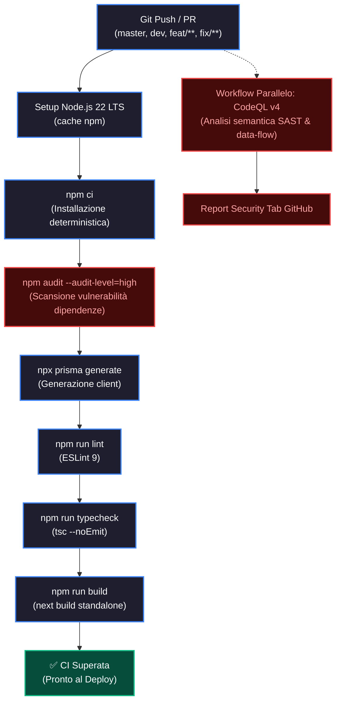

# DevOps — Pipeline CI/CD e Sicurezza (GitHub Actions)

Questo documento descrive il funzionamento dell'infrastruttura di **Continuous Integration (CI)** e **DevSecOps** configurata con GitHub Actions per garantire la stabilità, la tipizzazione rigorosa e la sicurezza del codice prima del rilascio.

---

## Obiettivi della Pipeline

La pipeline agisce come un cancello di controllo automatico prima che qualsiasi modifica venga integrata nei rami stabili (`dev` e `master`).

Ogni volta che viene eseguito un `push` o aperta una `pull_request`, i workflow di GitHub Actions verificano in un ambiente Ubuntu vergine:

1. **Integrità delle dipendenze**: Verifica con `npm ci` che il lockfile `package-lock.json` sia deterministico.
2. **Audit delle Vulnerabilità**: Rilevamento automatico di vulnerabilità note con `npm audit --audit-level=high`.
3. **Qualità del codice (Linting)**: Rispetto delle regole ESLint (assenza di `any`, import inutilizzati, etc.).
4. **Rigore dei tipi (Typecheck)**: Nessun errore di tipo TypeScript nel codebase (`tsc --noEmit`).
5. **Compilazione di Produzione (Build)**: Successo di `next build` per chunk e static pages.
6. **Analisi Statica di Sicurezza (SAST CodeQL)**: Analisi semantica del codice sorgente contro OWASP Top 10 e secret hardcoded.



---

## 1. Workflow Principale: Build & Typecheck (`.github/workflows/ci.yml`)

### Trigger e Concurrency Control

```yaml
on:
  push:
    branches:
      - master
      - dev
      - 'feat/**'
      - 'fix/**'
  pull_request:
    branches:
      - master
      - dev

concurrency:
  group: ${{ github.workflow }}-${{ github.ref }}
  cancel-in-progress: true
```

- **Branch monitorati**: `master`, `dev`, qualsiasi ramo di funzionalità (`feat/**`) o di correzione (`fix/**`).
- **`cancel-in-progress: true`**: Se uno sviluppatore invia più commit in rapida successione, GitHub Actions interrompe immediatamente le esecuzioni precedenti per risparmiare risorse.

### Step Salienti del Job `validate`

1. **`npm ci` (Clean Install)**:  
   Installa rigorosamente le versioni registrate in `package-lock.json` senza mai alterarlo.
2. **Security Audit (`npm audit --audit-level=high`)**:  
   Scansiona le dipendenze contro il database CVE. Se trova problemi critici o di alta gravità, blocca la pipeline.
3. **`npx prisma generate`**:  
   Genera i tipi TypeScript del client Prisma prima della compilazione.
4. **`npm run lint`**:  
   Analisi statica delle convenzioni e delle best practice con ESLint.
5. **`npm run typecheck`**:  
   Controllo statico del type system (`tsc --noEmit`).
6. **`npm run build`**:  
   Compilazione della build Next.js con export `standalone`.

---

## 2. Workflow SAST: GitHub CodeQL v4 (`.github/workflows/codeql.yml`)

CodeQL esegue l'analisi statica semantica del codice JavaScript e TypeScript senza eseguirlo:

```yaml
name: "Security / CodeQL SAST"

on:
  push:
    branches: [ master, dev ]
  pull_request:
    branches: [ master, dev ]
  schedule:
    - cron: '0 6 1 * *' # Scansione mensile automatica il 1° giorno del mese alle 06:00 UTC

jobs:
  analyze:
    name: CodeQL Security Analysis
    runs-on: ubuntu-latest
    permissions:
      security-events: write
      actions: read
      contents: read

    steps:
      - name: Checkout Repository
        uses: actions/checkout@v4

      - name: Initialize CodeQL
        uses: github/codeql-action/init@v4
        with:
          languages: 'javascript-typescript'

      - name: Perform CodeQL Analysis
        uses: github/codeql-action/analyze@v4
```

- **Versionamento v4**: Utilizza le GitHub Actions v4 ufficiali per il pieno supporto a Node.js 24 sui runner moderni.
- **Data-Flow Analysis**: Traccia il flusso di dati dall'input utente fino a database e comandi di sistema, rilevando vulnerabilità OWASP (SQL injection, XSS, auth bypass, secret hardcoded).
- **Cadenza Bilanciata**: Si attiva ad ogni `push` e `pull_request` su `master` e `dev`, più una singola scansione mensile preventiva.

---

## 3. Gestione Dipendenze Vulnerabili Interne (`overrides`)

Quando una dipendenza interna (transitiva) di una libreria principale presenta una vulnerabilità (come nel caso di `postcss` annidato dentro Next.js 15), l'uso di `npm audit fix --force` rischia di forzare l'installazione di una major version incompatibile (es. Next.js 16).

Per risolvere questo problema senza breaking change, utilizziamo il campo nativo `overrides` in `package.json`:

```json
"overrides": {
  "postcss": "$postcss"
}
```

Questo vincola npm a risolvere `postcss` sempre e ovunque alla versione sicura e aggiornata (`^8.5.3`) presente in `devDependencies`, eliminando la vulnerabilità a monte.

---

## 4. Replica dei Controlli CI in Locale

Prima di effettuare un commit o un push, lo sviluppatore può replicare in locale tutti i controlli eseguiti dalla CI:

```bash
# 1. Verifica di formattazione, linting, tipi e build
npm run check:ci

# 2. Verifica di sicurezza delle dipendenze
npm audit --audit-level=high
```

Se entrambi i comandi restituiscono codice di uscita `0`, la pipeline remota GitHub Actions passerà con esito verde garantito.
