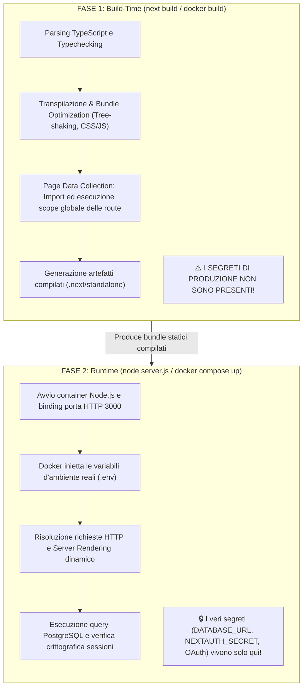

# Teoria — Build-time vs Runtime e Gestione dei Segreti

Questo documento analizza una delle distinzioni più critiche dello sviluppo
moderno con Next.js e Docker: la differenza tra **fase di compilazione
(Build-time)** e **fase di esecuzione (Runtime)**, spiegando nel dettaglio la
causa e la risoluzione dell'errore di build legato a `NEXTAUTH_SECRET`.

---

## La Distinzione Fondamentale

Nei framework tradizionali Node.js/Express, il codice viene eseguito solo quando
il server si avvia. In Next.js (App Router), il ciclo di vita è suddiviso in due
mondi distinti:



---

## Perché i Segreti Non Devono Essere Presenti a Build-Time

Una regola cardinale di sicurezza nei container Docker è:

> **Mai passare password di database, API keys private o secret di sessione come
> argomenti di build (`ARG`) in un Dockerfile.**

Se si passasse `NEXTAUTH_SECRET` durante `docker build`:

1. Il valore del segreto rimarrebbe per sempre inciso nella cronologia dei layer
   dell'immagine Docker (`docker history`).
2. Chiunque avesse accesso all'immagine Docker (es. su Docker Hub o registro
   privato) potrebbe estrarre il segreto in chiaro e falsificare token di
   autenticazione per qualsiasi utente.

I segreti devono essere iniettati **esclusivamente a runtime** tramite variabili
d'ambiente (`environment` in `docker-compose.yml`).

---

## Anatomia del Bug Risolto in `lib/auth.ts`

### Il Codice Problematico Precedente:

```typescript
// VECCHIO CODICE ERRATO:
secret: (() => {
  if (!process.env.NEXTAUTH_SECRET && process.env.NODE_ENV === 'production') {
    throw new Error(
      "NEXTAUTH_SECRET non è definita. Impostala come variabile d'ambiente in produzione."
    );
  }
  return process.env.NEXTAUTH_SECRET || 'super_secret_local_dev_key_12345';
})(),
```

### Perché la Build Docker Falliva?

1. Nel Dockerfile, al comando `RUN npm run build`, Next.js imposta
   `NODE_ENV=production`.
2. Durante la fase di **Page Data Collection**, Next.js analizza staticamente
   `/api/auth/[...nextauth]/route.ts`.
3. Il modulo importa `lib/auth.ts`, che esegue immediatamente la sua IIFE
   (Immediately Invoked Function Expression) per inizializzare l'oggetto di
   configurazione.
4. Poiché a build-time `NEXTAUTH_SECRET` non è presente nei layer Docker, la
   condizione `!process.env.NEXTAUTH_SECRET && NODE_ENV === 'production'`
   risultava **vera**!
5. Il codice lanciava `throw new Error(...)`, provocando l'errore:
   ```text
   > Build error occurred
   [Error: Failed to collect page data for /api/auth/[...nextauth]]
   failed to solve: process "/bin/sh -c npm run build" did not complete successfully: exit code: 1
   ```

---

## Il Pattern di Risoluzione Corretto

La soluzione adottata in [lib/auth.ts](../../lib/auth.ts):

```typescript
// NUOVO CODICE ROBUSTO:
// In produzione a runtime NextAuth esige NEXTAUTH_SECRET (o AUTH_SECRET).
// A build-time (es. docker build) Next.js esegue le route per static analysis:
// usiamo un fallback per non far fallire la compilazione.
secret:
  process.env.NEXTAUTH_SECRET ||
  process.env.AUTH_SECRET ||
  'super_secret_local_dev_key_12345',
```

### Come Funziona Questo Approccio:

- **A Build-Time**: Next.js valuta il file, legge la stringa di fallback
  temporanea, conclude l'analisi statica della route e completa con successo la
  generazione delle pagine (`14/14`). Nessun segreto viene memorizzato nei file
  statici.
- **A Runtime**: Quando il container Docker si avvia, Docker Compose monta il
  file `.env` popolando `process.env.NEXTAUTH_SECRET` con la vera chiave
  crittografica. NextAuth a runtime utilizzerà la vera chiave per firmare i
  cookie JWT, garantendo massima sicurezza senza bloccare il ciclo di rilascio.

---

## Variabili Server-Side vs Client-Side (`NEXT_PUBLIC_*`)

In Next.js la visibilità delle variabili d'ambiente è regolata dal prefisso:

| Variabile                         | Prefisso           | Dove è visibile?                                                         | Comportamento a Build-Time                                                                                                            |
| :-------------------------------- | :----------------- | :----------------------------------------------------------------------- | :------------------------------------------------------------------------------------------------------------------------------------ |
| `DATABASE_URL`, `NEXTAUTH_SECRET` | _Nessun prefisso_  | **Solo sul Server** (Server Components, Server Actions, Route Handlers). | Se richiamata in un Client Component (`'use client'`), Next.js la sostituisce con `undefined` per prevenire leak di sicurezza.        |
| `NEXT_PUBLIC_APP_URL`             | **`NEXT_PUBLIC_`** | **Sia sul Server che nel Browser del Client**.                           | Il compilatore cerca tutte le occorrenze nel codice client e le **sostituisce letteralmente** con il valore stringa durante la build. |
