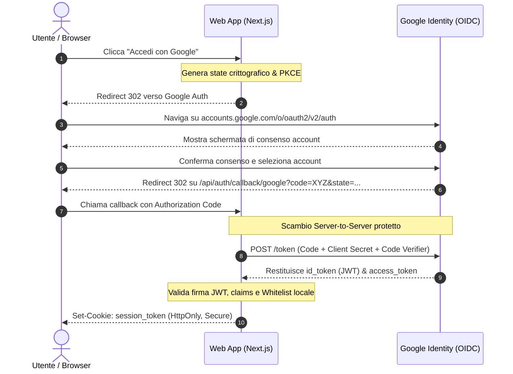

# Teoria — SSO, Protocolli OAuth 2.0 e Gestione Sessioni

Questo documento illustra i fondamenti teorici dell'autenticazione federata
(SSO), il funzionamento dello standard **OAuth 2.0 / OpenID Connect (OIDC)** e
la differenza architetturale tra sessioni basate su Database e sessioni
stateless basate su **JWT**.

---

## Cos'è il Single Sign-On (SSO)?

Il **Single Sign-On (SSO)** è un meccanismo di controllo accessi che consente a
un utente di autenticarsi una sola volta presso un fornitore di identità
centralizzato (_Identity Provider_ o **IdP**, come Google, Microsoft o GitHub) e
accedere in modo trasparente a molteplici applicazioni web indipendenti
(_Service Provider_ o **SP**).

### Perché usare SSO invece dell'autenticazione locale con password?

1. **Sicurezza Superiore**: Nessuna memorizzazione di credenziali o hash di
   password (es. bcrypt/argon2) nel database dell'applicazione. Se il database
   dell'app venisse compromesso, nessun attaccante potrebbe sottrarre password
   degli utenti.
2. **Zero Overhead per Funzionalità Complesse**: L'applicazione eredita
   gratuitamente i meccanismi di sicurezza dell'IdP: autenticazione a due
   fattori (2FA / MFA), rilevamento accessi sospetti, notifiche push e gestione
   del recupero account.
3. **Migliore User Experience**: L'utente non deve inventare né ricordare una
   nuova password per l'applicazione; effettua il login con un solo click
   sfruttando la sessione Google già aperta nel browser.

---

## Autenticazione (OIDC) vs Autorizzazione (OAuth 2.0)

Spesso confusi, rappresentano due concetti distinti:

- **OAuth 2.0 (Autorizzazione)**: Protocollo nato per consentire a
  un'applicazione di accedere a risorse protette di un utente per suo conto (es.
  _"consenti all'app X di leggere i contatti Google"_). Il risultato è un
  `access_token`.
- **OpenID Connect / OIDC (Autenticazione)**: È uno strato di identità costruito
  **al di sopra di OAuth 2.0**. Fornisce informazioni verificate su **chi è
  l'utente**. Il risultato è un **`id_token`** (un token JWT firmato
  crittograficamente da Google contenente email, nome, foto e identificatore
  univoco `sub`).

---

## Il Flusso "Authorization Code Grant with PKCE"

È lo standard di sicurezza industriale per applicazioni web per scambiare
credenziali senza esporre token nel browser:



> [!IMPORTANT] **Perché lo scambio (step 8) avviene Server-to-Server?**  
> Il `Client Secret` di Google non viene mai inviato al browser del client.
> Rimane custodito esclusivamente nel server Node.js; il browser maneggia solo
> un codice temporaneo monouso (`Authorization Code`) che da solo non ha alcun
> valore senza il segreto.

---

## Strategie di Sessione: Stateful vs Stateless (JWT)

Dopo che l'utente è stato autenticato da Google, l'applicazione deve ricordare
che la richiesta successiva proviene da lui. Esistono due approcci:

| Caratteristica                | Sessioni su Database (Stateful)                                                                      | Sessioni JWT (Stateless)                                                                                                          |
| :---------------------------- | :--------------------------------------------------------------------------------------------------- | :-------------------------------------------------------------------------------------------------------------------------------- |
| **Come funziona**             | Il server crea un record nella tabella `sessions` e invia un cookie con l'ID casuale della sessione. | Il server crea un token JSON contenente i dati utente, lo firma con una chiave segreta (`NEXTAUTH_SECRET`) e lo invia nel cookie. |
| **Query al Database**         | **Richiesta a ogni singola chiamata HTTP** per validare il cookie contro la tabella `sessions`.      | **Zero query al database**: il server verifica solo la firma matematica del token in memoria (CPU bound).                         |
| **Revoca Immediata**          | Istantanea: basta cancellare la riga dal database.                                                   | Richiede meccanismi di scadenza breve (es. 24h o 30 giorni) o blacklist in cache.                                                 |
| **Scelta in questo progetto** | Supportata tramite Prisma Adapter (`Session`).                                                       | **Strategia attiva (`strategy: 'jwt'`)**: garantisce tempi di risposta sub-millisecondo nella dashboard.                          |

### La Struttura di un JSON Web Token (JWT)

Un JWT è composto da tre parti separate da un punto (`.`):
$$\text{header}.\text{payload}.\text{signature}$$

1. **Header (Base64)**: Specifica l'algoritmo di firma (es. `HS256` o `HS512`).
2. **Payload (Base64)**: Contiene le informazioni utente (claims):
   ```json
   {
     "id": "cmv731so90000my01feqcvmiq",
     "email": "lucadileo70@gmail.com",
     "role": "ADMIN",
     "color": "#3b82f6",
     "iat": 1740000000,
     "exp": 1742592000
   }
   ```
3. **Signature**: Generata calcolando:
   $$\text{HMACSHA256}(\text{header} + "." + \text{payload}, \text{NEXTAUTH\_SECRET})$$
   Se chiunque tentasse di modificare il ruolo da `PLAYER` ad `ADMIN` nel
   payload, la firma risulterebbe invalida e il server respingerebbe la
   richiesta all'istante.
