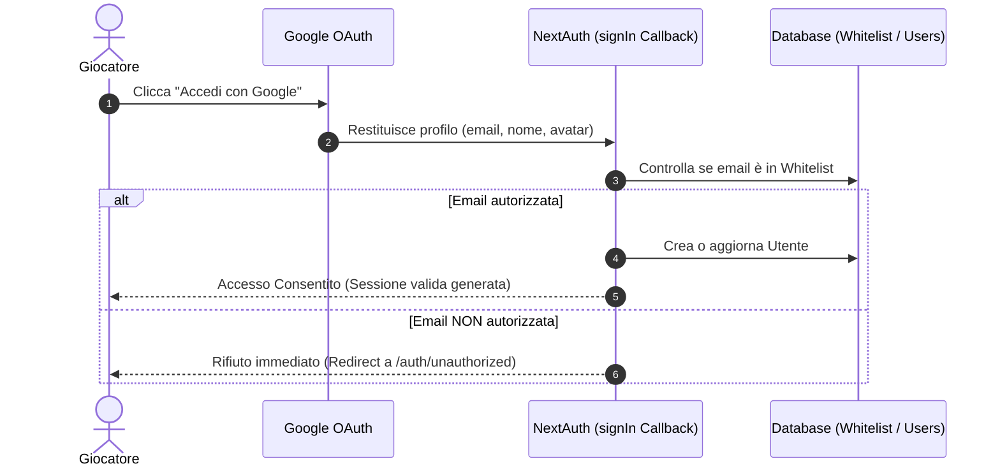
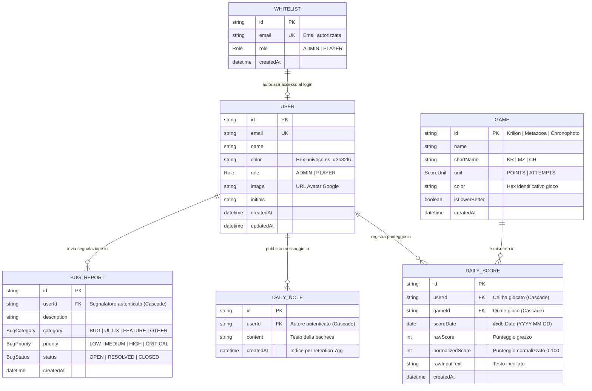

# 📋 Architectural & Refactoring Recap: "Who Is Losing Today?"

Documento riassuntivo di sintesi sulle decisioni architetturali, di sicurezza, data model, identità visiva, flussi DTO ed evoluzione concordate per il refactoring dell'applicazione.

---

## 1. Architettura Dati: Da API Routes a Server Actions & Server Components

### Il Problema Attuale
- **Overfetching & Cascata HTTP**: I Client Component (`use client`) fanno `fetch('/api/...')` con `useEffect`, generando waterfall di richieste di rete dal browser verso il server Next.js.
- **Doppia Esposizione**: Ogni API Route (`/api/scores`, `/api/summary`, ecc.) è un endpoint pubblico HTTP raggiungibile da chiunque conosca l'URL o analizzi i network tab del browser.
- **Duplicazione della Logica**: Validazione, controllo sessione e mapping dei dati vengono ripetuti tra le API routes e i servizi.

### La Nuova Strategia Implementativa

1. **Lettura Dati (Read Operations) $\rightarrow$ Server Components + Data Access Layer**:
   - Creare un modulo dedicato all'accesso dati (es. `lib/data/` o `lib/repositories/`, es. `daily.ts`, `period.ts`, `user.ts`).
   - I Server Components (le pagine `page.tsx`) chiamano **direttamente le funzioni TypeScript** del Data Access Layer durante il rendering HTML sul server.
   - **Vantaggi**: Zero latenza di rete client-server per i dati iniziali, niente spinner a vuoto, zero endpoint HTTP esposti per la sola visualizzazione, bundle JavaScript ridotto nel browser.

2. **Scrittura Dati (Write Operations / Mutazioni) $\rightarrow$ Server Actions**:
   - Creare azioni con direttiva `'use server'` (es. in `app/actions/scores.ts` o `app/actions/notes.ts`).
   - Le Server Actions:
     1. Verificano la sessione sul server (`await getServerSession(authOptions)`).
     2. Validano l'input con **Zod** (impedendo payload malevoli o tipi errati).
     3. Eseguono la mutazione su Prisma.
     4. Chiamano `revalidatePath('/')` o `revalidateTag('leaderboard')` per aggiornare istantaneamente la cache Next.js senza ricaricare la pagina.
   - **Vantaggi**: Chiamate RPC tipizzate end-to-end, protezione CSRF integrata di Next.js, nessun bisogno di mantenere URL di API route.

---

## 2. Autenticazione: Login Google con Meccanismo Whitelist

### Il Problema Attuale
- Qualsiasi utente con un account Google può cliccare su *"Accedi con Google"*, entrare nell'app e interagire (o addirittura spammare note o punteggi se ci sono fallback insicuri).

### La Soluzione Whitelist (Invite-Only)

Manteniamo la comodità del login con Google (nessuna password da gestire, 2FA di Google, avatar automatico), ma vincoliamo l'accesso a una **lista approvata**.



### Implementazione Tecnica

1. **Tabella DB Essenziale (`Whitelist`)**:
   - Struttura ultra-semplice: solo `id`, `email`, `role`, `createdAt`.
   - Niente campi superflui (niente note, niente authorizedBy).

2. **Hook `signIn` in NextAuth (`lib/auth.ts`)**:
   ```typescript
   async signIn({ user, account, profile }) {
     if (!user.email) return false;
     const normalizedEmail = user.email.toLowerCase().trim();

     const allowed = await prisma.whitelist.findUnique({
       where: { email: normalizedEmail }
     });

     if (!allowed) {
       // Blocco totale: NextAuth rifiuta il cookie di sessione
       return "/auth/unauthorized";
     }

     return true;
   }
   ```

3. **Auto-provisioning del Ruolo**:
   - Nei callback `jwt` e `session` di NextAuth, iniettiamo il ruolo (`role: allowed.role`) nel token di sessione.

---

## 3. Middleware e Misure di Sicurezza

### Mappa dei Layer di Protezione

| Livello | Meccanismo | Obiettivo |
|---|---|---|
| **1. Edge / Routing** | `middleware.ts` | Blocca all'origine qualsiasi richiesta verso `/dashboard`, `/admin` o pagine private se manca il token di sessione NextAuth. |
| **2. Application / Auth** | NextAuth `signIn` callback | Impedisce la creazione di sessioni per utenti non in whitelist. |
| **3. Mutation / Actions** | Auth check + Zod validation | Ogni Server Action verifica sessione e tipizzazione del payload prima di toccare Prisma. |
| **4. Rate Limiting** | In-memory / Upstash Redis | Previene spam su invio note della bacheca o invio punteggi (es. max 10 richieste/minuto per IP/utente). |
| **5. Database Integrity** | PostgreSQL Unique Constraints + `@db.Date` | Impossibile inserire punteggi duplicati per lo stesso giorno/gioco (`@@unique([userId, gameId, scoreDate])`). |

### Middleware Next.js Globale (`middleware.ts`)
```typescript
// middleware.ts
export { default } from "next-auth/middleware";

export const config = {
  matcher: [
    "/admin/:path*",
    "/profile/:path*",
    "/leaderboard/:path*",
    "/api/admin/:path*",
    "/api/scores/:path*",
  ],
};
```

### Validazione Dati Rigorosa con Zod
```typescript
export const SubmitScoreSchema = z.object({
  gameId: z.string().min(1),
  rawScore: z.number().int().min(0).max(100000),
  scoreDate: z.string().regex(/^\d{4}-\d{2}-\d{2}$/, "Formato data non valido (YYYY-MM-DD)"),
  rawInputText: z.string().max(1000).optional(),
});
```

---

## 4. Modifiche al Database (Prisma & PostgreSQL)

### Principi Fondamentali del Data Model

1. **Legame Utente Rigoroso al 100%**:
   Qualsiasi entità (Punteggio, Nota della bacheca, Bug report) **è obbligatoriamente legata a un utente registrato** (`userId String` mai null, `onDelete: Cascade`). Non esistono record anonimi o orfani.
2. **Formula del Totale Giornaliero (Sempre divisa per 3)**:
   Per penalizzare chi salta i giochi:
   * Gioco saltato = 0 punti.
   * Punteggio del giorno: $\text{Totale} = (\text{Krilion} + \text{Metazooa} + \text{Chronophoto}) / 3$.
3. **Colori Esadecimali per Giocatori e Giochi**:
   * **Utenti**: `color String @default("#3b82f6")` (usato per le linee del grafico di gruppo nella Dashboard e gli avatar).
   * **Giochi**: `color String` nel modello `Game` (usato per i badge, le card Hall of Fame e il grafico personale nel Profilo):
     * 🟢 **Krilion**: `#10b981` (Verde smeraldo)
     * 🟠 **Metazooa**: `#f59e0b` (Arancione safari)
     * 🟣 **Chronophoto**: `#8b5cf6` (Viola retrò)
     * 🔵 **Totale**: `#3b82f6` (Blu zaffiro)
4. **Data pura `@db.Date`**:
   PostgreSQL memorizza solo `YYYY-MM-DD`, azzerando i bug da fuso orario dopo le ore 22:00.
5. **Indici Composti per Prestazioni (<2ms)**:
   * `@@index([scoreDate, gameId])` su `DailyScore` per la dashboard.
   * `@@index([userId, scoreDate])` su `DailyScore` per il profilo e streak.
   * `@@index([createdAt])` su `DailyNote` per la retention a 7 giorni.

---

### Diagramma ER del Database (Entity-Relationship)



---

### Schema Prisma Completo (`schema.prisma`)

```prisma
datasource db {
  provider  = "postgresql"
  url       = env("DATABASE_URL")
  directUrl = env("DIRECT_URL")
}

generator client {
  provider = "prisma-client-js"
}

// ------------------------------------------------------
// ENUM
// ------------------------------------------------------

enum Role {
  ADMIN
  PLAYER
}

enum ScoreUnit {
  POINTS
  ATTEMPTS
}

enum BugCategory {
  BUG
  UI_UX
  FEATURE
  OTHER
}

enum BugPriority {
  LOW
  MEDIUM
  HIGH
  CRITICAL
}

enum BugStatus {
  OPEN
  RESOLVED
  CLOSED
}

// ------------------------------------------------------
// WHITELIST & AUTENTICAZIONE
// ------------------------------------------------------

model Whitelist {
  id        String   @id @default(cuid())
  email     String   @unique
  role      Role     @default(PLAYER)
  createdAt DateTime @default(now())

  @@map("whitelist")
}

model User {
  id            String    @id @default(cuid())
  name          String?
  email         String?   @unique
  emailVerified DateTime?
  image         String?
  initials      String?
  role          Role      @default(PLAYER)
  color         String    @default("#3b82f6") // Colore esadecimale per grafici (Recharts) e avatar
  createdAt     DateTime  @default(now())
  updatedAt     DateTime  @updatedAt

  accounts      Account[]
  sessions      Session[]
  dailyScores   DailyScore[]
  dailyNotes    DailyNote[]
  bugReports    BugReport[]

  @@map("users")
}

model Account {
  id                String  @id @default(cuid())
  userId            String
  type              String
  provider          String
  providerAccountId String
  refresh_token     String? @db.Text
  access_token      String? @db.Text
  expires_at        Int?
  token_type        String?
  scope             String?
  id_token          String? @db.Text
  session_state     String?

  user User @relation(fields: [userId], references: [id], onDelete: Cascade)

  @@unique([provider, providerAccountId])
  @@map("accounts")
}

model Session {
  id           String   @id @default(cuid())
  sessionToken String   @unique
  userId       String
  expires      DateTime

  user User @relation(fields: [userId], references: [id], onDelete: Cascade)

  @@map("sessions")
}

model VerificationToken {
  identifier String
  token      String   @unique
  expires    DateTime

  @@unique([identifier, token])
  @@map("verification_tokens")
}

// ------------------------------------------------------
// GIOCHI & PUNTEGGI
// ------------------------------------------------------

model Game {
  id            String       @id // es: "Krilion", "Metazooa", "Chronophoto"
  name          String
  shortName     String       // es: "KR", "MZ", "CH"
  unit          ScoreUnit    @default(POINTS)
  color         String       @default("#10b981") // Colore iconico del gioco
  isLowerBetter Boolean      @default(false)
  createdAt     DateTime     @default(now())

  dailyScores   DailyScore[]

  @@map("games")
}

model DailyScore {
  id              String   @id @default(cuid())
  userId          String
  gameId          String
  rawScore        Int
  normalizedScore Int
  scoreDate       DateTime @db.Date  // Solo YYYY-MM-DD: zero bug di timezone UTC/GMT
  rawInputText    String?
  createdAt       DateTime @default(now())

  user User @relation(fields: [userId], references: [id], onDelete: Cascade)
  game Game @relation(fields: [gameId], references: [id], onDelete: Cascade)

  @@unique([userId, gameId, scoreDate])
  @@index([scoreDate, gameId])
  @@index([userId, scoreDate])
  @@map("daily_scores")
}

// ------------------------------------------------------
// BACHECA TEMPORANEA (7 GIORNI) - LEGATA AD UTENTE
// ------------------------------------------------------

model DailyNote {
  id        String   @id @default(cuid())
  userId    String   // OBBLIGATORIO: chiunque scrive è autenticato
  content   String   @db.Text
  createdAt DateTime @default(now())

  user User @relation(fields: [userId], references: [id], onDelete: Cascade)

  @@index([createdAt])
  @@map("daily_notes")
}

// ------------------------------------------------------
// SEGNALAZIONE BUG & FEEDBACK - LEGATA AD UTENTE
// ------------------------------------------------------

model BugReport {
  id          String      @id @default(cuid())
  userId      String      // OBBLIGATORIO: segnalazione sempre tracciabile all'autore
  description String      @db.Text
  category    BugCategory @default(BUG)
  priority    BugPriority @default(MEDIUM)
  status      BugStatus   @default(OPEN)
  createdAt   DateTime    @default(now())

  user User @relation(fields: [userId], references: [id], onDelete: Cascade)

  @@index([status, priority])
  @@map("bug_reports")
}
```

---

## 5. Flusso Dati Dettagliato: Dal DB ai DTO, alla Lavorazione Backend fino al Frontend

### Diagramma del Flusso Applicativo con Frecce Colorate per Canale

Ogni canale di elaborazione ha un colore distintivo per tracciare il flusso dal database al componente:
- 🔵 **Blu**: Flusso Giornaliero (Dashboard Blocco 1)
- 🟣 **Viola**: Flusso Storico di Periodo & Hall of Fame (Dashboard Blocco 2)
- 🟢 **Verde**: Flusso Profilo Utente
- 🟠 **Arancione**: Flusso Bacheca Messaggi
- 🔴 **Rosso**: Flusso Scritture / Server Actions

```mermaid
flowchart TD
    subgraph UI [Livello Presentazione: React & Next.js]
        A1[DailySummaryCards & DailyRankingsTable]
        A2[LeaderboardTable & TrendChart & HallOfFame]
        A3[PersonalStatsCard & PersonalTrendChart]
        A4[DailyChalkboard]
        A5[GameScoreInput Form]
    end

    subgraph DTO_Layer [Contratti Tipizzati: DTO & Schemi Zod]
        B1[DailyResultsDTO]
        B2[PeriodResultsDTO & HallOfFameDTO]
        B3[UserProfileDTO]
        B4[DailyNoteDTO]
        B5[SubmitScoreSchema - Zod]
    end

    subgraph Backend [Logica di Business & Data Layer sul Server]
        direction TB
        C1["getDailyResults(date)"]
        C2["getPeriodResults(startDate, endDate) & getHallOfFame()"]
        C3["getUserProfile(userId)"]
        C4["getActiveNotes()"]
        C5["submitScoreAction('use server')"]
        Auth["Controllo Sessione NextAuth & Whitelist"]
    end

    subgraph DB [Persistenza: Prisma ORM & PostgreSQL]
        D1[(users)]
        D2[(daily_scores)]
        D3[(daily_notes)]
        D4[(whitelist)]
    end

    %% Flusso 1: Giornaliero (BLU)
    C1 ==>|1. Calcola medie / winner / loser| B1
    B1 ==>|2. Renderizza giornata| A1
    C1 <.->|Query scoreDate| D2
    C1 <.->|Include user| D1

    %% Flusso 2: Storico Periodo & Hall of Fame (VIOLA)
    C2 -->|1. Aggrega periodo, pivot trend & record| B2
    B2 -->|2. Renderizza tabella, Recharts & card| A2
    C2 <.->|Query range date & record assoluti| D2
    C2 <.->|Include user| D1

    %% Flusso 3: Profilo Utente (VERDE)
    C3 -.->|1. Calcola streak / cucchiai / record| B3
    B3 -.->|2. Renderizza statistiche personali| A3
    C3 <.->|Query storico utente| D2
    C3 <.->|Dati profilo| D1

    %% Flusso 4: Bacheca Messaggi (ARANCIONE)
    C4 ==>|1. Inietta flag isAuthor| B4
    B4 ==>|2. Renderizza messaggi 7gg| A4
    C4 <.->|Query createdAt 7gg| D3
    C4 <.->|Include author| D1

    %% Flusso 5: Scritture Server Actions (ROSSO)
    A5 -.->|1. Invia payload| B5
    B5 -.->|2. Valida input Zod| C5
    C5 -.->|3. Verifica autorizzazione| Auth
    Auth <.->|Verifica whitelist| D4
    C5 -.->|4. Upsert sicuro @db.Date| D2
    C5 -.->|5. Invalida cache revalidatePath| A1

    %% Stili Frecce per Flusso
    linkStyle 0,1 stroke:#2563eb,stroke-width:3px;
    linkStyle 4,5 stroke:#9333ea,stroke-width:3px;
    linkStyle 8,9 stroke:#16a34a,stroke-width:3px;
    linkStyle 12,13 stroke:#ea580c,stroke-width:3px;
    linkStyle 16,17,18,20,21 stroke:#dc2626,stroke-width:3px;
```



---

### DTO Comune Base Utente (`UserSummaryDTO`)
```typescript
// lib/types/user.ts
export interface UserSummaryDTO {
  id: string
  name: string
  color: string             // Hex univoco giocatore (es. "#3b82f6")
  image?: string | null
}
```

---

### FLUSSO 1 · La Giornata Puntuale (Dashboard - Blocco 1)

#### 1. DTO (`DailyResultsDTO`)
```typescript
// lib/types/daily.ts
import { UserSummaryDTO } from "./user"

export interface DailyPlayerScore {
  user: UserSummaryDTO
  rawScore: number          // Tentativi o punti reali
  normalizedScore: number   // Punteggio normalizzato 0-100
  rank: number              // Posizione: 1, 2, 3...
}

export interface DailyResultsDTO {
  date: string              // "2026-10-18"
  totalPlayers: number      // Quanti hanno partecipato in questa data
  winner: DailyPlayerScore | null
  loser: DailyPlayerScore | null  // REGOLA: null se totalPlayers < 2
  rankings: {
    totale: DailyPlayerScore[]
    krilion: DailyPlayerScore[]
    metazooa: DailyPlayerScore[]
    chronophoto: DailyPlayerScore[]
  }
}
```

#### 2. Query Prisma al Database
**Una sola query** per la data solare:
```typescript
const scores = await prisma.dailyScore.findMany({
  where: { scoreDate: new Date(dateStr) },
  include: {
    user: { select: { id: true, name: true, color: true, image: true } }
  }
})
```

#### 3. Lavorazione Backend
* Formula totale del giorno: `(krilionNorm + metazooaNorm + chronophotoNorm) / 3` (chi salta un gioco prende 0).
* Assegna `winner = rankings.totale[0]` e `loser = totalPlayers >= 2 ? rankings.totale[last] : null`.

#### 4. Frontend Rendering
* Card Perdente del giorno con cucchiaio 🥄 e vincitore 🥇.
* Classifica del giorno con switch istantaneo tra le linguette dei giochi.

---

### FLUSSO 2 · Il Periodo Storico & Hall of Fame (Dashboard - Blocco 2)

#### 1. DTO (`PeriodResultsDTO` & `HallOfFameDTO`)
```typescript
// lib/types/period.ts
import { UserSummaryDTO } from "./user"

export interface PeriodLeaderboardRow {
  user: UserSummaryDTO
  playedCount: number       // Partite completate nel periodo
  totalPoints: number       // Somma totale dei punti nel periodo
  averageScore: number      // Media normalizzata del periodo (ordinamento)
  bestScore: number         // Punteggio più alto fatto nel periodo
  rank: number              // 1, 2, 3...
}

export interface TrendPointDTO {
  date: string              // "12 Ott", "13 Ott"...
  [userId: string]: string | number // Punti di ogni utente con chiave userId
}

export interface PeriodGameData {
  leaderboard: PeriodLeaderboardRow[]
  trendData: TrendPointDTO[]
}

export interface PeriodResultsDTO {
  startDate: string
  endDate: string
  players: UserSummaryDTO[] // Lista giocatori per associare Line stroke={player.color}
  totale: PeriodGameData
  krilion: PeriodGameData
  metazooa: PeriodGameData
  chronophoto: PeriodGameData
}

export interface AllTimeRecordItem {
  gameId: string
  score: number
  unit: string
  date: string              // Data in cui è stato stabilito
  holder: UserSummaryDTO    // Chi detiene il record
}

export interface HallOfFameDTO {
  krilion: AllTimeRecordItem
  metazooa: AllTimeRecordItem
  chronophoto: AllTimeRecordItem
  totale: AllTimeRecordItem
}
```

#### 2. Mockup Visivo Tabella Periodo (`LeaderboardTable.tsx`)
```
┌──────┬──────────────────────┬─────────────┬──────────────┬──────────────┬──────────────┐
│ POS  │ GIOCATORE            │ PARTITE     │ PUNTI TOTALI │ RECORD (MAX) │ MEDIA PUNTI  │
├──────┼──────────────────────┼─────────────┼──────────────┼──────────────┼──────────────┤
│ #1 🥇│ 🔵 Luca (Avatar)     │ 28 / 30     │ 2.420 pt     │ 98 pt        │ 86.4 pt      │
│ #2 🥈│ 🔴 Marco (Avatar)    │ 30 / 30     │ 2.436 pt     │ 94 pt        │ 81.2 pt      │
│ #3 🥉│ 🟢 Andrea (Avatar)   │ 22 / 30     │ 1.628 pt     │ 88 pt        │ 74.0 pt      │
└──────┴──────────────────────┴─────────────┴──────────────┴──────────────┴──────────────┘
```

#### 3. Card Hall of Fame (Record di Sempre)
```
┌──────────────────┬──────────────────┬──────────────────┬───────────────┐
│ 👑 KRILION       │ 🦊 METAZOOA      │ 📸 CHRONOPHOTO   │ 🌟 TOTALE     │
│ 4.850 pt         │ 2 tentativi      │ 4.920 pt         │ 96.0 pt       │
│ 🔵 Luca          │ 🔴 Marco         │ 🟢 Andrea        │ 🔵 Luca       │
│ 14 Maggio 2026   │ 03 Settembre 2026│ 18 Ottobre 2026  │ 12 Giugno 2026│
└──────────────────┴──────────────────┴──────────────────┴───────────────┘
```
*Aggiornamento a costo zero*: Ogni volta che un punteggio supera il record, `revalidatePath('/dashboard')` aggiorna la card all'istante in automatico.

---

### FLUSSO 3 · Pagina Profilo Utente (`/profile/[userId]`)

*Nota: La cronologia delle singole partite passate è stata eliminata per mantenere la pagina snella e focalizzata.*

#### 1. DTO (`UserProfileDTO`)
```typescript
// lib/types/user-profile.ts
import { UserSummaryDTO } from "./user"

export interface GameStatsSummary {
  played: number
  averageScore: number
  bestScore: number
}

export interface UserPersonalTrendPoint {
  date: string              // "18 Ott"
  krilion?: number
  metazooa?: number
  chronophoto?: number
  totale?: number
}

export interface UserProfileDTO {
  user: UserSummaryDTO
  role: "ADMIN" | "PLAYER"
  streak: number             // Giorni consecutivi attuali reali
  streakRecord: number       // Massimo storico di giorni consecutivi
  totalGamesPlayed: number   // Partite totali assolute
  woodenSpoonsCount: number  // Quante volte è stato l'ULTIMO del giorno 🥄
  dailyWinsCount: number     // Quante volte è stato il PRIMO del giorno 🥇
  statsByGame: {
    krilion: GameStatsSummary
    metazooa: GameStatsSummary
    chronophoto: GameStatsSummary
  }
  personalTrend: UserPersonalTrendPoint[]
}
```

#### 2. Grafico Personale a Linee Multi-Gioco
Nel profilo dell'utente, le linee del grafico a linee Recharts usano **i colori iconici dei giochi**:
* Linea 🟢 Verde: Krilion
* Linea 🟠 Arancione: Metazooa
* Linea 🟣 Viola: Chronophoto
* Linea 🔵 Blu: Totale Giornaliero

---

### FLUSSO 4 · Bacheca Messaggi a 7 Giorni (`DailyChalkboard`)
* DTO: `DailyNoteDTO` (id, content, createdAt, isAuthor, author: UserSummaryDTO).
* Query con indice su `createdAt >= now() - 7 days`.
* Render con barra laterale del colore personale dell'autore.

---

### FLUSSO 5 · Mutazioni di Scrittura (Server Actions)
* Tutte le mutazioni (`submitScoreAction`, `createNoteAction`, `deleteNoteAction`, `updateUserColorAction`, ecc.) sono protette con Zod e sessione server, con revalidazione automatica della cache.

---

## 6. Inventario Completo dei Dati Mostrati nella Piattaforma

### 🏠 DASHBOARD (`/dashboard`)
1. **Navigatore Giorno & Tab Giochi**: Tasti data (`<` `>` / datepicker), tab `Totale | Krilion | Metazooa | Chronophoto`.
2. **Card "Chi sta perdendo oggi" (🥄)**: Avatar, nome, colore, punteggio del perdente (oppure messaggio attesa se <2 giocatori).
3. **Card "Il migliore di oggi" (🥇)**: Avatar, nome, colore, punteggio del vincitore.
4. **Classifica del Giorno**: Posizione, giocatore, punteggio grezzo, punteggio normalizzato, dettagli 3 giochi nel totale.
5. **Form Inserimento (`GameScoreInput`)**: Gioco, input punteggio/incolla testo, stato "già completato oggi".
6. **Bacheca 7 Giorni (`DailyChalkboard`)**: Messaggi con avatar, nome, barra colorata, orario e tasto elimina per l'autore.
7. **Card Hall of Fame 🏆**: 4 card per Krilion, Metazooa, Chronophoto e Totale con record, detentore, avatar e data.
8. **Classifica di Periodo (Tabella)**: Posizione medaglie, giocatore, partite giocate, punti totali, best score, media punti.
9. **Grafico Trend Temporale (Recharts)**: Asse X date, asse Y punti, linee colorate personali per ciascun giocatore, tooltip interattivo.

### 👤 PROFILO UTENTE (`/profile` e `/profile/[userId]`)
1. **Header**: Avatar Google, nome, ruolo (`ADMIN` / `PLAYER`), color-picker personale (solo sul proprio profilo).
2. **Statistiche Chiave**: Partite totali, Vittorie di giornata (🥇), Cucchiai di legno (🥄), Streak attuale (🔥), Streak record (⚡).
3. **Card per Singolo Gioco**: Partite, media e record personale per Krilion, Metazooa e Chronophoto.
4. **Grafico Personale a Linee**: Andamento temporale con le linee colorate dei 3 giochi (verde, arancione, viola) e totale (blu).

### 🛡️ PANNELLO ADMIN (`/admin`)
1. **Tabella Whitelist**: Email autorizzate, ruolo, data inserimento, form invito nuova email, tasto revoca/elimina.
2. **Tabella Bug Report**: Segnalatore, data, categoria, priorità, testo, menu a tendina per cambiare stato (*Aperto*, *Risolto*, *Chiuso*).

---

## 7. Roadmap e Miglioramenti Futuri

### Fase 1: Consolidamento Tecnico (Priorità Alta)
- [ ] Creazione tabella `Whitelist` e migrazione Prisma (con preservazione dei dati esistenti).
- [ ] Implementazione callback `signIn` con blocco email e pagina dedicata `/auth/unauthorized`.
- [ ] `middleware.ts` per blindare le route riservate.
- [ ] Refactoring schema DB: `@db.Date`, enum, legami obbligatori a `User`, colori hex e colore nel modello `Game`.
- [ ] Definizione dei DTO in `lib/types/` e refactoring di `DailyScore` creation tramite Server Action con validazione Zod.

### Fase 2: Architettura e Pulizia (Priorità Media)
- [ ] Implementazione delle funzioni del Data Access Layer (`lib/data/daily.ts`, `period.ts`, `user.ts`, `notes.ts`, `hall-of-fame.ts`).
- [ ] Migrazione delle pagine principali a **Server Components** con data fetching diretto dai DTO.
- [ ] Dismissione e cancellazione graduale delle vecchie API routes ridondanti (`/api/scores`, `/api/summary`, ecc.).
- [ ] Navigazione profilo dinamica `/profile/[userId]` con rimozione della cronologia partite.
- [ ] Sezione Hall of Fame e sistema di gestione Admin.

### Fase 3: Funzionalità & UX Evoluta (Visione Futura)
- [ ] **Leghe / Gruppi Multipli**: Stanze private oltre alla classifica globale.
- [ ] **Badge & Notifiche (Web Push / Telegram Bot)**: Avviso serale per chi non ha ancora giocato.
- [ ] **Audit Log & Cron Job di Backup**: Snapshot periodici dei punteggi e pulizia automatica bacheca oltre 7 giorni.
