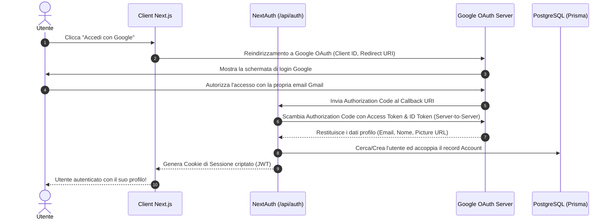

# Teoria, Architettura e Infrastruttura del Sistema

Questo documento fornisce una spiegazione teorica ed architetturale approfondita dei concetti fondamentali alla base dell'applicazione **Who Is Losing Today**: **Autenticazione OAuth 2.0**, **PostgreSQL & Prisma ORM**, **Containerizzazione Docker** e **Matematica di Normalizzazione dei Punteggi**.

---

## Parte 1: Teoria dell'Autenticazione (OAuth 2.0 & Sessioni)

### 1.1 Il Flusso OAuth 2.0 Authorization Code Flow
L'applicazione utilizza lo standard **OAuth 2.0 (OpenID Connect)** per consentire agli utenti di autenticarsi con il proprio account Google senza mai inserire la propria password sulla nostra piattaforma.



### 1.2 Gestione della Sessione (JWT & Cookie HTTP-Only)
- **JWT (JSON Web Token)**: Quando il login ha esito positivo, NextAuth genera un token JWT firmato con la chiave `NEXTAUTH_SECRET`.
- **Cookie HTTP-Only & SameSite**: Il token viene salvato nel browser all'interno di un cookie sicuro, inaccessibile a script dannosi (protezione da attacchi XSS - Cross-Site Scripting).
- **Session Hydration**: Ad ogni caricamento pagina, l'hook `useSession()` o la chiamata `getServerSession()` decodifica il token lato server e rende i dati dell'utente disponibili nell'interfaccia.

---

## Parte 2: Teoria del Database & Infrastruttura (PostgreSQL, Prisma & Docker)

### 2.1 Perché un Database Relazionale (PostgreSQL)?
Per tracciare i punteggi e le classifiche nel tempo, un **Database Relazionale (RDBMS)** come PostgreSQL è la scelta ideale rispetto ad un DB NoSQL per tre motivi chiave:
1. **Integrità Referenziale (Foreign Keys)**: Un punteggio (`daily_scores`) è fortemente vincolato sia all'utente (`users`) che al gioco (`games`). Se un utente viene eliminato, la regola `ON DELETE CASCADE` pulisce automaticamente i suoi punteggi.
2. **Vincoli di Unicità (`@@unique`)**: Impedisce che uno stesso utente inserisca due volte un punteggio per lo stesso gioco nello stesso giorno (`@@unique([userId, gameId, scoreDate])`).
3. **Transazioni ACID**: Garantisce che i dati siano sempre coerenti e mai corrotti durante le operazioni di scrittura contemporanee.

### 2.2 Il Ruolo di Prisma ORM
**Prisma** è un Object-Relational Mapper che funge da ponte tra il codice TypeScript e la base di dati PostgreSQL:

```text
TypeScript Code (app) <---> Prisma Client (@prisma/client) <---> SQL Query Engine <---> PostgreSQL DB
```

* **PSL (Prisma Schema Language)**: Nel file [`prisma/schema.prisma`](file:///c:/Users/lucad/my-projects/who-is-losing-today/prisma/schema.prisma) definiamo la struttura logica dei modelli in modo neutro rispetto al motore DB.
* **Type-Safety**: Prisma genera automaticamente le interfacce TypeScript dal file di schema. Se provi a scrivere un campo inesistente o di tipo errato, il compilatore di TypeScript segnala subito l'errore in fase di sviluppo.
* **Prisma Migrations**: Gestisce l'evoluzione dello schema nel tempo attraverso comandi come `npx prisma db push` o `npx prisma migrate dev`.

### 2.3 Containerizzazione con Docker
**Docker** permette di isolare il servizio PostgreSQL in un contenitore leggero e riproducibile:

* **Container**: Un ambiente di esecuzione isolato contenente il binario di PostgreSQL 16.
* **Volume Persistente (`postgres_data`)**: I dati del database risiedono in un volume gestito da Docker al di fuori del contenitore. Anche se il contenitore viene fermato o riavviato, i tuoi dati **non vanno mai persi**.
* **Mappatura Porte (`5432:5432`)**: Collega la porta interna di PostgreSQL alla porta `5432` del tuo computer host (`localhost`), rendendolo accessibile sia a Prisma che a tool visivi come DBeaver o Prisma Studio.

---

## Parte 3: Matematica della Normalizzazione dei Punteggi

Poiché l'applicazione confronta giochi con meccaniche e scale numeriche completamente diverse tra loro, è necessario un algoritmo matematico di **Normalizzazione** per calcolare una classifica generale equa.

### 1. Krilion (Punteggio Diretto 0 - 100)
Krilion assegna già un punteggio percentuale da 0 a 100:
$$\text{Score}_{\text{normalized}} = \min(100, \text{Score}_{\text{raw}})$$

### 2. Metazooa (Tentativi - Minore è Meglio)
In Metazooa l'obiettivo è indovinare l'animale nel minor numero di tentativi possibile:
- 1 tentativo = 100 punti (perfetto)
- 2 tentativi = 90 punti
- 3 tentativi = 80 punti
- $N$ tentativi = $100 - (N - 1) \times 10$ punti

$$\text{Score}_{\text{normalized}} = \max(0, 100 - (\text{Score}_{\text{raw}} - 1) \times 10)$$

### 3. Chronophoto (Punti Tempo 0 - 5.000)
In Chronophoto si accumulano punti da 0 a 5.000 indovinando l'anno delle fotografie:
$$\text{Score}_{\text{normalized}} = \min\left(100, \left\lfloor \frac{\text{Score}_{\text{raw}}}{5000} \times 100 \right\rfloor\right)$$

### 4. Punteggio Complessivo Totale (Media Ponderata)
Il punteggio complessivo del giocatore sulla classifica generale è dato dalla media aritmetica dei punteggi normalizzati di tutti i giochi disputati:
$$\text{OverallScore} = \left\lfloor \frac{\text{Score}_{\text{KR}} + \text{Score}_{\text{MZ}} + \text{Score}_{\text{CH}}}{3} \right\rceil$$
