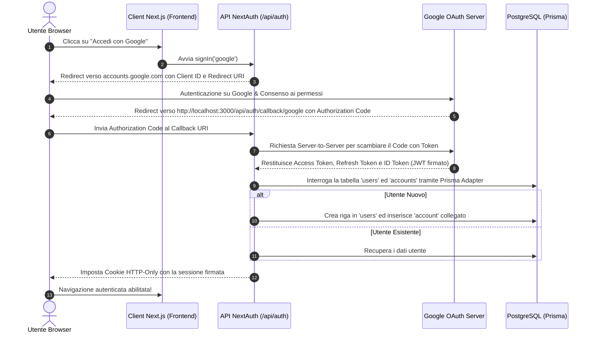

# Teoria dell'Autenticazione: OAuth 2.0, SSO e NextAuth

Questo documento fornisce una trattazione teorica completa dell'autenticazione **SSO (Single Sign-On)** con **Google OAuth 2.0**, la gestione della sessione tramite **JWT (JSON Web Token)** ed il loro funzionamento all'interno del framework **Next.js (NextAuth / Auth.js)** con **Prisma Adapter**.

---

## 1. Che cos'è il Single Sign-On (SSO) ed OAuth 2.0?

### **Single Sign-On (SSO)**
Il Single Sign-On è un meccanismo di autenticazione federata che consente a un utente di accedere a molteplici applicazioni web utilizzando un'unica identità gestita da un provider di terze parti fidato (Identity Provider - IdP), come **Google**, senza dover creare nuove password per ogni sito.

### **OAuth 2.0 (OpenID Connect)**
OAuth 2.0 è il protocollo standard industriale per l'autorizzazione. Sopra OAuth 2.0 si innesta il livello di autenticazione **OpenID Connect (OIDC)**, che fornisce le informazioni sul profilo utente (Nome, Email, Foto avatar, ID unico di Google).

---

## 2. Il Flusso Authorization Code (Passo per Passo)

Il flusso di autenticazione utilizzato da Google e NextAuth è l'**Authorization Code Flow with PKCE**, il più sicuro in ambito web.

### **Dettaglio delle Fasi**:

1. **Iniziazione**: L'utente clicca il pulsante *Accedi con Google*.
2. **Redirect al Provider**: Il browser viene reindirizzato sui server di Google fornendo due parametri chiave:
 - `client_id`: Identifica l'applicazione *Who Is Losing Today*.
 - `redirect_uri`: `http://localhost:3000/api/auth/callback/google`.
3. **Consenso dell'Utente**: L'utente si autentica su Google e concede l'accesso alle informazioni base (`email`, `profile`).
4. **Codice Temporaneo**: Google reindirizza il browser al nostro Callback URI restituendo un **Authorization Code** a durata brevissima (pochi secondi).
5. **Scambio Server-to-Server**: NextAuth (dal backend dell'app) contatta direttamente i server di Google per scambiare il codice temporaneo con le credenziali reali. Questa chiamata avviene da server a server, quindi la chiave segreta `GOOGLE_CLIENT_SECRET` non viene mai esposta al browser o al pubblico.
6. **Persistenza nel Database**: Il `PrismaAdapter` riceve le informazioni da Google:
 - Se l'utente non si era mai registrato, crea un record nella tabella `users` ed una riga corrispondente in `accounts`.
 - Se era già registrato, collega l'accesso al suo ID utente esistente.

---

## 3. Gestione della Sessione: JWT vs Database Sessions

NextAuth supporta due strategie principali per gestire la sessione degli utenti:

### 3.1 Strategia JWT (JSON Web Token) — *Adottata nel progetto*
- **Come funziona**: Dopo il login, NextAuth crea un token **JWT** contenente le informazioni dell'utente (`id`, `email`, `name`, `image`). Questo token viene crittografato e firmato con la chiave `NEXTAUTH_SECRET` e salvato in un **Cookie HTTP-Only**.
- **Vantaggi**:
 - **Zero Query al DB ad ogni richiesta**: Il server non deve interrogare il database ad ogni cambio di pagina per verificare se l'utente è autenticato. Decodifica semplicemente la firma del Cookie.
 - **Massima Velocità**: Adatto per serverless e Next.js App Router.

### 3.2 Sicurezza dei Cookie (`HTTP-Only` e `SameSite`)
Per proteggere l'utente da attacchi informatici:
- **`HttpOnly`**: Il cookie non è accessibile tramite codice JavaScript (`document.cookie`), rendendolo immune ad attacchi **XSS (Cross-Site Scripting)**.
- **`SameSite=Lax`**: Impedisce l'invio del cookie da siti terzi non autorizzati, proteggendo da attacchi **CSRF (Cross-Site Request Forgery)**.
- **`Secure`**: In produzione (HTTPS) forza la trasmissione dei token solo su canali crittografati.

---

## 4. Integrazione con Prisma Adapter

Senza un adapter, i dati dell'utente rimarrebbero salvati unicamente nel cookie temporaneo.
Grazie al **`@auth/prisma-adapter`**, NextAuth si collega direttamente allo schema PostgreSQL:

* **Tabella `users`**: Mantiene l'anagrafica utente (`id`, `name`, `email`, `image`, `initials`, `color`).
* **Tabella `accounts`**: Mantiene il collegamento tra l'utente ed il provider esterno (es. `provider: "google"`, `providerAccountId: "10982347192384"`).
* **Tabella `sessions`**: Utilizzata in caso di strategia di sessione via DB.
* **Tabella `verification_tokens`**: Utilizzata in caso di login via email senza password (Magic Links).

Grazie a questo collegamento, quando l'utente loggato inserisce un nuovo punteggio in *Who Is Losing Today*, l'applicazione conosce esattamente il suo `user.id` di PostgreSQL e registra la partita a suo nome!
